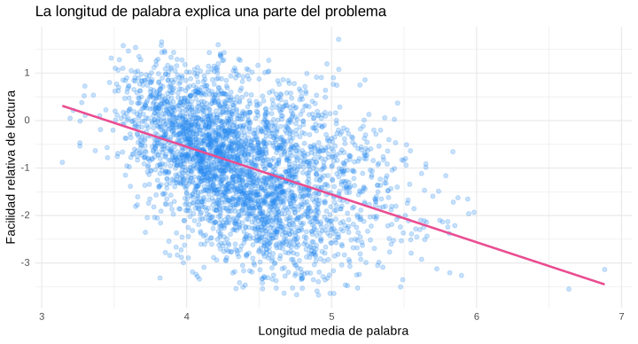

<div class="hero">
<span class="eyebrow">AMPLIACIÓN · IA EDUCATIVA · DATOS REALES</span>
<h1>¿Qué tan fácil es leer un texto?</h1>
<p>Una aplicación en evaluación de materiales de lectura: estadísticas clásicas, características del lenguaje y una respuesta derivada de juicios humanos.</p>
</div>

## 1. Problema y definición rigurosa de la respuesta

Imaginemos una biblioteca digital que desea recomendar textos adecuados para sus estudiantes. El problema supervisado es estimar una **puntuación de facilidad de lectura** usando propiedades medibles del texto. La base real [CLEAR Corpus](https://github.com/scrosseye/CLEAR-Corpus) contiene aproximadamente 4.724 fragmentos textuales en inglés y una puntuación `BT_easiness` derivada de comparaciones de dificultad evaluadas por docentes.

**Importante:** una puntuación **más alta** de `BT_easiness` indica mayor facilidad relativa de lectura según el modelo de juicios humanos. Esta escala **no es una probabilidad ni un porcentaje**; por tanto, no dividiremos por cinco ni la restringiremos a \([0,1]\).

Fuente primaria: Crossley y colaboradores (2022). *A large-scaled corpus for assessing text readability*. [Artículo abierto](https://pmc.ncbi.nlm.nih.gov/articles/PMC10027808/). La base oficial puede usarse con reconocimiento y respetando la licencia indicada en su repositorio.


## 2. Descargar, validar y comprender la base original


``` r
# PASO 1. Descargar el archivo del repositorio ORIGINAL de los autores.
destino <- "datos/CLEAR_corpus_final.xlsx"
if (!file.exists(destino)) {
  download.file(
    "https://raw.githubusercontent.com/scrosseye/CLEAR-Corpus/main/CLEAR_corpus_final.xlsx",
    destfile=destino, mode="wb", quiet=TRUE
  )
}

# PASO 2. Leer los nombres tal como aparecen en la hoja de cálculo.
raw <- readxl::read_xlsx(destino)
print(dim(raw))
```

```
## [1] 4724   28
```

``` r
print(names(raw))
```

```
##  [1] "ID"                                 "Author"                            
##  [3] "Title"                              "Anthology"                         
##  [5] "URL"                                "Pub Year"                          
##  [7] "Categ"                              "Sub Cat"                           
##  [9] "Lexile Band"                        "Location"                          
## [11] "License"                            "MPAA Max"                          
## [13] "MPAA #Max"                          "MPAA# Avg"                         
## [15] "Excerpt"                            "Google WC"                         
## [17] "Sentence Count"                     "Paragraphs"                        
## [19] "BT_easiness"                        "s.e."                              
## [21] "Flesch-Reading-Ease"                "Flesch-Kincaid-Grade-Level"        
## [23] "Automated Readability Index"        "SMOG Readability"                  
## [25] "New Dale-Chall Readability Formula" "CAREC"                             
## [27] "CAREC_M"                            "CML2RI"
```

``` r
# PASO 3. Extraer exactamente la respuesta y las variables de contexto.
columnas <- c("Excerpt","BT_easiness","Google WC","Sentence Count",
              "Paragraphs","Categ","s.e.")
stopifnot(all(columnas %in% names(raw)))
dat <- data.frame(
  texto=as.character(raw[["Excerpt"]]),
  facilidad=as.numeric(raw[["BT_easiness"]]),
  palabras=as.numeric(raw[["Google WC"]]),
  oraciones=as.numeric(raw[["Sentence Count"]]),
  parrafos=as.numeric(raw[["Paragraphs"]]),
  categoria=as.character(raw[["Categ"]]),
  error_etiqueta=as.numeric(raw[["s.e."]])
)
dat <- dat[complete.cases(dat[c("texto","facilidad","palabras",
                                 "oraciones","parrafos")]),]
dat <- dat[dat$palabras>0 & dat$oraciones>0 & dat$parrafos>0,]

# PASO 4. Inspección estadística transparente.
print(summary(dat[c("facilidad","palabras","oraciones","parrafos")]))
```

```
##    facilidad          palabras     oraciones         parrafos     
##  Min.   :-3.6763   Min.   :125   Min.   : 2.000   Min.   : 1.000  
##  1st Qu.:-1.6966   1st Qu.:158   1st Qu.: 7.000   1st Qu.: 1.000  
##  Median :-0.9091   Median :174   Median : 8.000   Median : 2.000  
##  Mean   :-0.9576   Mean   :172   Mean   : 9.571   Mean   : 2.542  
##  3rd Qu.:-0.2034   3rd Qu.:186   3rd Qu.:11.000   3rd Qu.: 3.000  
##  Max.   : 1.7114   Max.   :205   Max.   :41.000   Max.   :20.000
```

``` r
print(table(dat$categoria, useNA="ifany"))
```

```
## 
## Info  Lit 
## 2304 2420
```

``` r
print(summary(dat$error_etiqueta))
```

```
##    Min. 1st Qu.  Median    Mean 3rd Qu.    Max. 
##  0.0000  0.4687  0.4845  0.4912  0.5061  0.6497
```

**Interpretación de `dim`:** la primera dimensión indica fragmentos en la tabla original; la segunda, campos disponibles, incluidos metadatos y fórmulas de legibilidad. Después de eliminar filas con datos faltantes, verifique cuántos fragmentos quedan en `dat` y documente su decisión.

**Interpretación de `summary`:** la mediana de `facilidad` resume la localización de una variable que puede incluir valores negativos. `Google WC` es un recuento de palabras; `Sentence Count` y `Paragraphs` son conteos. Son variables explicativas, **no etiquetas de facilidad**.

**Interpretación de `table(categoria)`:** permite comparar la composición por tipo de texto. Si una categoría domina, la evaluación global podría ocultar diferencias por género.

**Interpretación de `summary(dat$error_etiqueta)`:** `s.e.` cuantifica la incertidumbre estimada de la etiqueta de facilidad derivada del modelo de comparación entre textos; no es el error que comete nuestra regresión ni el error estándar de una pendiente. Su presencia ofrece una posible ampliación a regresión ponderada según precisión de etiqueta, que sería una **pregunta distinta** de la robustez LAD/Huber que estudiamos aquí.


``` r
# PASO 5. Inspeccionar ejemplos contrastantes SIN eliminar el contenido textual.
ord <- order(dat$facilidad)
ejemplos <- dat[c(head(ord,2),tail(ord,2)),
                c("facilidad","palabras","oraciones","texto")]
ejemplos$texto <- substr(ejemplos$texto, 1, 130)
print(ejemplos, row.names=FALSE)
```

```
##  facilidad palabras oraciones
##  -3.676268      177         8
##  -3.668360      194         7
##   1.658698      165        14
##   1.711390      143        13
##                                                                                                                               texto
##  The commutator is peculiar, consisting of only three segments of a copper ring, while in the simplest of other continuous current 
##  The Dunwich horror itself came between Lammas and the equinox in 1928, and Dr. Armitage was among those who witnessed its monstrou
##  The next morning Lizzy met her friend Spider and asked him, "Where have you been?" Spider replied, "I was looking for food to get 
##  When you think of dinosaurs and where they lived, what do you picture? Do you see hot, steamy swamps, thick jungles, or sunny plai
```

**Lectura aplicada:** en los ejemplos con puntaje alto, los docentes juzgaron el texto más fácil que los fragmentos con puntaje bajo. No suponga que una oración corta garantiza facilidad ni que el texto más difícil equivale a uno de «mala calidad».

## 3. Ingeniería de características textuales


``` r
# PASO 1. Una función de R que cuenta longitud media de palabra.
promedio_long_palabra <- function(texto) {
  tokens <- unlist(strsplit(tolower(texto),"[^[:alpha:]]+"))
  tokens <- tokens[nzchar(tokens)]
  if (!length(tokens)) return(NA_real_)
  mean(nchar(tokens))
}

# PASO 2. Crear rasgos cuantitativos; usar log evita escalas muy distintas.
dat$log_palabras <- log1p(dat$palabras)
dat$palabras_por_oracion <- dat$palabras/dat$oraciones
dat$long_palabra <- vapply(dat$texto,promedio_long_palabra,numeric(1))
dat <- dat[complete.cases(dat[c("facilidad","log_palabras",
                                "palabras_por_oracion","long_palabra")]),]

# PASO 3. Reservar entrenamiento, validación y prueba ANTES de estimar.
set.seed(523)
orden <- sample.int(nrow(dat))
n_ent <- floor(.70*nrow(dat))
n_val <- floor(.15*nrow(dat))
train <- dat[orden[seq_len(n_ent)],]
valid <- dat[orden[seq.int(n_ent+1,n_ent+n_val)],]
test  <- dat[orden[seq.int(n_ent+n_val+1,nrow(dat))],]
print(data.frame(Particion=c("Train","Validacion","Test"),
                 Textos=c(nrow(train),nrow(valid),nrow(test))))
```

```
##    Particion Textos
## 1      Train   3306
## 2 Validacion    708
## 3       Test    710
```

**Interpretación:** `log_palabras` mide volumen textual comprimido; `palabras_por_oracion` aproxima densidad sintáctica, y `long_palabra` aproxima complejidad léxica. Son medidas imperfectas: el vocabulario técnico puede contener palabras cortas y un texto breve puede ser difícil.


``` r
ggplot2::ggplot(train,ggplot2::aes(x=long_palabra,y=facilidad)) +
  ggplot2::geom_point(alpha=.25,color="#2788EF") +
  ggplot2::geom_smooth(method="lm",colour="#EA4C91",se=FALSE,linewidth=1.2) +
  ggplot2::labs(title="La longitud de palabra explica una parte del problema",
                x="Longitud media de palabra",y="Facilidad relativa de lectura") +
  ggplot2::theme_minimal(base_size=14)
```

<div class="figure" style="text-align: center">

<p class="caption">Asociación descriptiva entre facilidad de lectura y longitud media de palabra.</p>
</div>

**Cómo leer la gráfica:** un patrón promedio decreciente sugeriría menor facilidad en textos de palabras largas, pero las excepciones muestran por qué un modelo necesita más variables. Una pendiente descriptiva no demuestra un mecanismo causal.

## 4. Comparación predictiva real: LS, LAD y Huber


``` r
# PASO 1. Todas las técnicas reciben la misma fórmula múltiple.
f <- facilidad ~ log_palabras + palabras_por_oracion + long_palabra

# PASO 2. Ajustar cada método SOLO con textos de entrenamiento.
m_ls <- lm(f, data=train)
m_lad <- quantreg::rq(f, tau=.5, data=train)
m_huber <- MASS::rlm(f,data=train,method="M",
                     psi=MASS::psi.huber,maxit=200)

# PASO 3. Imprimir las tres salidas.
summary(m_ls)
```

```
## 
## Call:
## lm(formula = f, data = train)
## 
## Residuals:
##      Min       1Q   Median       3Q      Max 
## -2.91252 -0.58520  0.02818  0.61709  2.63468 
## 
## Coefficients:
##                       Estimate Std. Error t value Pr(>|t|)    
## (Intercept)          11.422314   0.805324  14.183   <2e-16 ***
## log_palabras         -1.476035   0.152459  -9.682   <2e-16 ***
## palabras_por_oracion -0.034977   0.001681 -20.810   <2e-16 ***
## long_palabra         -0.916202   0.034447 -26.597   <2e-16 ***
## ---
## Signif. codes:  0 '***' 0.001 '**' 0.01 '*' 0.05 '.' 0.1 ' ' 1
## 
## Residual standard error: 0.8707 on 3302 degrees of freedom
## Multiple R-squared:  0.2968,	Adjusted R-squared:  0.2962 
## F-statistic: 464.6 on 3 and 3302 DF,  p-value: < 2.2e-16
```

``` r
summary(m_lad,se="boot",R=150)
```

```
## 
## Call: quantreg::rq(formula = f, tau = 0.5, data = train)
## 
## tau: [1] 0.5
## 
## Coefficients:
##                      Value     Std. Error t value   Pr(>|t|) 
## (Intercept)           11.84576   0.97609   12.13596   0.00000
## log_palabras          -1.51081   0.18129   -8.33343   0.00000
## palabras_por_oracion  -0.03879   0.00276  -14.03939   0.00000
## long_palabra          -0.94753   0.04103  -23.09350   0.00000
```

``` r
summary(m_huber)
```

```
## 
## Call: rlm(formula = f, data = train, psi = MASS::psi.huber, maxit = 200, 
##     method = "M")
## Residuals:
##      Min       1Q   Median       3Q      Max 
## -2.94166 -0.59406  0.02046  0.60459  2.61848 
## 
## Coefficients:
##                      Value    Std. Error t value 
## (Intercept)           11.5426   0.8320    13.8740
## log_palabras          -1.4807   0.1575    -9.4010
## palabras_por_oracion  -0.0366   0.0017   -21.0551
## long_palabra          -0.9288   0.0356   -26.0999
## 
## Residual standard error: 0.8885 on 3302 degrees of freedom
```

### Cómo interpretar los resultados

**LS:**

- `(Intercept)` predice la facilidad para valores explicativos cero. Puede no tener sentido práctico porque los textos reales tienen conteos positivos; para interpretar un texto típico, use `predict` con sus medias o medianas.
- `log_palabras`: asociación con el logaritmo del número de palabras, manteniendo constantes las demás características. Un aumento de una unidad en este logaritmo **no** significa una palabra adicional.
- `palabras_por_oracion`: diferencia estimada de facilidad ante **una palabra más por oración**, con lo demás constante.
- `long_palabra`: diferencia estimada ante una letra adicional en la longitud media de palabra.
- `Std. Error`, `t value`, `Pr(>|t|)`: precisión e inferencia clásica bajo supuestos; **no convierten** una asociación observacional en causalidad.
- `Residual standard error` expresa magnitud de residuos en puntos del índice CLEAR; `R-squared` muestra ajuste en train, no rendimiento en test.

**LAD:** las mismas pendientes describen cambios en la **mediana condicional**, y los errores estándar/bootstrap requieren reconocer la variabilidad de remuestreo.

**Huber:** las pendientes describen el ajuste robusto con una pérdida intermedia. `MASS::rlm` no produce, por defecto, valores p clásicos comparables con los de `lm`. Consulte los pesos robustos si necesita saber qué registros influyeron menos.


``` r
# PASO 4. Imprimir frases con valores REALES calculados por los estudiantes.
for (nom in c("log_palabras","palabras_por_oracion","long_palabra")) {
  cat(sprintf(
    "LS: si %s aumenta una unidad con las demás constantes, la facilidad estimada cambia %+.4f puntos CLEAR.\n",
    nom, coef(m_ls)[[nom]]
  ))
}
```

```
## LS: si log_palabras aumenta una unidad con las demás constantes, la facilidad estimada cambia -1.4760 puntos CLEAR.
## LS: si palabras_por_oracion aumenta una unidad con las demás constantes, la facilidad estimada cambia -0.0350 puntos CLEAR.
## LS: si long_palabra aumenta una unidad con las demás constantes, la facilidad estimada cambia -0.9162 puntos CLEAR.
```

``` r
cat(sprintf("R² ajustado LS en entrenamiento: %.3f.\n",
            summary(m_ls)$adj.r.squared))
```

```
## R² ajustado LS en entrenamiento: 0.296.
```

``` r
cat(sprintf("Escala robusta interna de Huber: %.3f.\n",m_huber$s))
```

```
## Escala robusta interna de Huber: 0.889.
```

## 5. Validación para elegir y prueba para confirmar


``` r
# PASO 1. Métricas en la unidad original del índice CLEAR.
evaluar <- function(y,p,nom) data.frame(
  Modelo=nom,MAE=mean(abs(y-p)),
  RMSE=sqrt(mean((y-p)^2)),
  Spearman=unname(cor(y,p,method="spearman")))

modelos <- list(LS=m_ls,LAD=m_lad,Huber=m_huber)
tabla_para <- function(base) {
  do.call(rbind, lapply(names(modelos),function(nom)
    evaluar(base$facilidad, as.numeric(predict(modelos[[nom]],newdata=base)),
            nom)))
}
valores_valid <- tabla_para(valid)
print(valores_valid[order(valores_valid$MAE),],row.names=FALSE)
```

```
##  Modelo       MAE      RMSE  Spearman
##     LAD 0.6838422 0.8622380 0.5608063
##   Huber 0.6842880 0.8619193 0.5597937
##      LS 0.6846129 0.8620894 0.5587293
```

``` r
elegido <- valores_valid$Modelo[which.min(valores_valid$MAE)]
cat("Elegido por MAE de validación:",elegido,"\n")
```

```
## Elegido por MAE de validación: LAD
```

``` r
# PASO 2. Abrir test después de congelar la elección.
valores_test <- tabla_para(test)
print(valores_test[order(valores_test$MAE),],row.names=FALSE)
```

```
##  Modelo       MAE      RMSE  Spearman
##      LS 0.6884519 0.8616151 0.5360759
##   Huber 0.6888631 0.8624060 0.5373679
##     LAD 0.6907885 0.8648798 0.5397777
```

**Discusión de los resultados observados:** el método elegido antes de abrir
prueba fue **LAD**, pues tuvo el menor MAE en validación.
Su error en prueba fue **0.6908**,
mientras el menor MAE observado entre los tres métodos de prueba fue
**0.6885**. La posible inversión en el orden
es una lección sobre variabilidad entre particiones: **no se permite
reseleccionar usando test**, y diferencias tan pequeñas deben interpretarse
con prudencia, no como una victoria concluyente.

### Interpretación de la tabla

- **MAE**: error absoluto promedio de predicción en **puntos CLEAR**, no en porcentaje ni en unidades de legibilidad escolar.
- **RMSE**: también se mide en puntos CLEAR, con mayor penalización a predicciones muy equivocadas.
- **Spearman**: indica capacidad de **ordenar** textos desde más difíciles hasta más fáciles, y puede ser importante para un recomendador educativo.
- Un método puede dominar MAE pero perder en RMSE. Debata qué error tiene mayores consecuencias al recomendar materiales a estudiantes.
- Si el método ganador en test difiere del preseleccionado en validación, **no reemplace retroactivamente la elección**. Documente la discrepancia como incertidumbre del procedimiento de selección.

## 6. Desafío de robustez, sin falsificar la fuente


``` r
# PASO 1. Copiar etiquetas para simular contaminación SOLO en train.
set.seed(771)
train_ruido <- train
filas_ruido <- sample.int(nrow(train_ruido),round(.08*nrow(train_ruido)))

# PASO 2. Sumar de forma artificial una perturbación de gran tamaño.
# La base oficial NO contiene esta columna y NO se edita el archivo descargado.
tam <- 3*sd(train$facilidad)
train_ruido$facilidad[filas_ruido] <- train_ruido$facilidad[filas_ruido]+
  sample(c(-tam,tam),length(filas_ruido),replace=TRUE)

# PASO 3. Repetir los tres métodos con entradas idénticas.
ruido <- list(
  LS=lm(f,data=train_ruido),
  LAD=quantreg::rq(f,tau=.5,data=train_ruido),
  Huber=MASS::rlm(f,data=train_ruido,psi=MASS::psi.huber,
                   method="M",maxit=200))
resultado_ruido <- do.call(rbind,lapply(names(ruido),function(nom)
  evaluar(valid$facilidad,predict(ruido[[nom]],newdata=valid),nom)))
comparacion <- merge(valores_valid[c("Modelo","MAE")],
                     resultado_ruido[c("Modelo","MAE")],
                     by="Modelo",suffixes=c("_original","_simulado"))
comparacion$deterioro <- comparacion$MAE_simulado-comparacion$MAE_original
print(comparacion,row.names=FALSE)
```

```
##  Modelo MAE_original MAE_simulado     deterioro
##   Huber    0.6842880    0.6840699 -0.0002180663
##     LAD    0.6838422    0.6836272 -0.0002149998
##      LS    0.6846129    0.6844848 -0.0001280406
```

**Interpretación:** un `deterioro` positivo indica que el error en validación limpia aumentó tras la perturbación simulada. No se debe presentar esta simulación como evidencia de errores reales en los juicios humanos del CLEAR Corpus.

## 7. Ejercicios para discusión

1. Seleccione el método por MAE de validación y explique el valor de ese error a un docente que desea recomendar lecturas apropiadas.
2. ¿Por qué sería incorrecto interpretar `BT_easiness=1.5` como «150 % de facilidad»?
3. ¿Cuál pendiente sería más fácil de comunicar a un profesor: `palabras_por_oracion` o `log_palabras`? ¿Por qué?
4. Inspeccione pesos de Huber, muestre dos textos con pesos bajos y discuta si podrían contener vocabulario especializado.
5. Compare el error por categoría `Categ`. ¿Es posible que el promedio global esconda peor desempeño en textos informativos?
6. **Extensión de IA:** sustituya las variables superficiales por embeddings de oraciones preentrenados y use validación antes de abrir test. Compare justicia, costo computacional e interpretabilidad.

### Fuentes y trazabilidad

- Repositorio y datos oficiales: https://github.com/scrosseye/CLEAR-Corpus
- Publicación de datos: https://pmc.ncbi.nlm.nih.gov/articles/PMC10027808/
- Métodos: https://search.r-project.org/CRAN/refmans/MASS/html/rlm.html y https://search.r-project.org/CRAN/refmans/quantreg/html/rq.html

**Nota:** este laboratorio es autosuficiente y usa su propia partición aleatoria con semilla fija. Su procedimiento no pretende ser una evaluación oficial ni atribuye causalidad a las características del texto.
