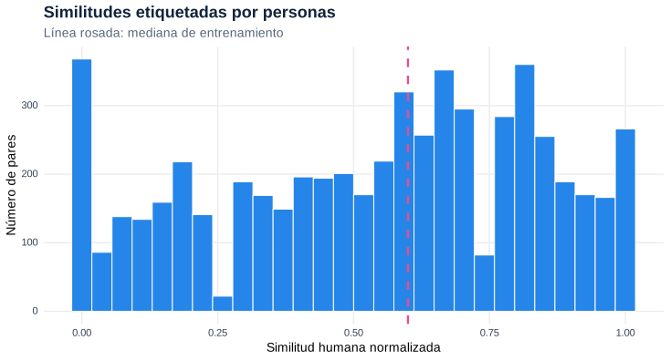
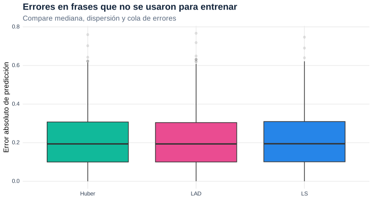

<div class="hero">
<span class="eyebrow">APRENDIZAJE SUPERVISADO · NLP · R</span>
<h1>¿Qué tan parecidas son dos frases?</h1>
<p>Un problema real de procesamiento de lenguaje natural resuelto mediante las mismas pérdidas que estudiamos en regresión clásica.</p>
<p class="pillrow"><span>Datos oficiales</span><span>Embeddings GloVe</span><span>LS · LAD · Huber</span><span>Red neuronal opcional</span></p>
</div>

> **Pregunta científica.** Si entrenamos un modelo con pares de frases cuya similitud fue evaluada por personas, ¿qué cambia cuando minimizamos cuadrados, valores absolutos o la pérdida de Huber? ¿Por qué la misma decisión aparece durante el entrenamiento de redes neuronales?

**Resultados de aprendizaje**

1. Construir *embeddings* de palabras y representar cada oración con un vector numérico.
2. Estimar modelos supervisados de similitud semántica usando LS, LAD y M de Huber.
3. Interpretar de forma rigurosa las salidas de R y las predicciones en unidades del problema.
4. Comparar el rendimiento en conjuntos de entrenamiento, validación y prueba separados.
5. Comprender cómo MSE, MAE y Huber reaparecen como funciones de pérdida al entrenar redes neuronales.
6. Distinguir resultados estadísticos de propiedades del sistema de NLP: asociación, no causalidad ni «comprensión» humana del lenguaje.

## 0. Orientación: el hilo conductor

\[
\text{Oraciones}\;\longrightarrow\;\text{embeddings}\;\longrightarrow\;
\mathbf{x}_i\;\longrightarrow\;\hat y_i=f_\theta(\mathbf{x}_i)
\;\longrightarrow\;\mathcal L(y_i,\hat y_i).
\]

Cada observación \(i\) contiene dos oraciones, un conjunto de características numéricas \(\mathbf x_i\), y una similitud humana \(y_i\in[0,1]\). **La pregunta que liga la estadística clásica con la IA es qué pérdida \(\mathcal L\) guía el ajuste.**

| Método | Objetivo por observación | Parámetro funcional típico | Una advertencia |
|:--|:--|:--|:--|
| LS | \(e^2\) | Media condicional si el modelo está bien especificado | Sensible a grandes errores de respuesta |
| LAD | \(|e|\) | Mediana condicional | No corrige puntos de alto apalancamiento por sí solo |
| M de Huber | \(\rho_\delta(e)\) | Centro robusto dependiente de \(\delta\) | Exige fijar escala y umbral |
| Red neuronal | Las mismas pérdidas, más una función \(f_\theta\) no lineal | Depende de arquitectura y pérdida | Más parámetros no implican mejor generalización |

La pérdida de Huber en la escala de puntuación es:

\[
\rho_\delta(e)=
\begin{cases}
\tfrac12 e^2,& |e|\leq\delta,\\
\delta\bigl(|e|-\tfrac12\delta\bigr),& |e|>\delta.
\end{cases}
\]

En `MASS::rlm`, el umbral opera sobre residuos estandarizados por una **escala robusta estimada**; en `keras3::loss_huber` se expresa directamente en unidades de la respuesta. No conviene identificar numéricamente ambos parámetros.

## 1. Preparación de RStudio

Ejecute una vez en la consola de R lo siguiente (no durante cada compilación):


``` r
# PASO 1. Instalar bibliotecas desde CRAN (ejecutar UNA sola vez).
install.packages(c(
  "readr", "dplyr", "ggplot2", "text2vec", "Matrix", "quantreg",
  "MASS", "knitr", "rmarkdown", "svglite", "readxl", "scales",
  "shiny", "bslib"
))
# PASO 2. Para el módulo opcional de red neuronal: véase sección 9.
# install.packages(c("keras3", "reticulate"))
```


**Interpretación de la preparación:** `set.seed` fija el muestreo pseudoaleatorio y facilita la reproducción. Esto no garantiza que el entrenamiento de una red neuronal sea bit a bit idéntico en todos los equipos.

## 2. Datos reales: STS Benchmark

**Origen oficial.** El conjunto STS Benchmark reúne pares de oraciones en inglés con evaluaciones humanas de similitud. En su versión original, las puntuaciones van de 0 a 5. Aquí las expresaremos en \([0,1]\) para comparar pérdidas con una red neuronal. El archivo proviene de la distribución oficial de Sentence-Transformers, basada en SemEval STS.

- Datos: https://sbert.net/datasets/stsbenchmark.tsv.gz
- Descripción: https://sbert.net/examples/sentence_transformer/training/sts/README.html
- Copia estructurada con `score` entre 0 y 1: https://huggingface.co/datasets/sentence-transformers/stsb


``` r
# PASO 1. Descargar el archivo oficial una sola vez; no usamos ejemplos inventados.
destino <- file.path("datos", "stsbenchmark.tsv.gz")
if (!file.exists(destino)) {
  download.file(
    url="https://sbert.net/datasets/stsbenchmark.tsv.gz",
    destfile=destino, mode="wb", quiet=TRUE
  )
}

# PASO 2. Leer TSV comprimido. Las oraciones se conservan como texto UTF-8.
sts <- readr::read_tsv(
  destino,
  col_types=readr::cols(.default=readr::col_character()),
  show_col_types=FALSE, progress=FALSE
)

# PASO 3. Validar el esquema y convertir la puntuación a numérica.
necesarias <- c("split", "sentence1", "sentence2", "score")
stopifnot(all(necesarias %in% names(sts)))
sts$score <- as.numeric(sts$score)
stopifnot(all(is.finite(sts$score)))
if (max(sts$score) > 1.01) sts$score <- sts$score / 5
stopifnot(all(sts$score >= 0 & sts$score <= 1))
sts$split <- tolower(sts$split)
sts$split[sts$split == "dev"] <- "validation"

# PASO 4. Respetar las particiones oficiales, sin repartir filas al azar.
ent <- as.data.frame(sts[sts$split == "train", ])
val <- as.data.frame(sts[sts$split == "validation", ])
pru <- as.data.frame(sts[sts$split == "test", ])
stopifnot(nrow(ent)>100, nrow(val)>100, nrow(pru)>100)

# PASO 5. Inspección de la base.
print(data.frame(Particion=c("Entrenamiento","Validación","Prueba"),
                 Pares=c(nrow(ent),nrow(val),nrow(pru))))
```

```
##       Particion Pares
## 1 Entrenamiento  5749
## 2    Validación  1500
## 3        Prueba  1379
```

``` r
print(head(ent[c("sentence1","sentence2","score")], 3))
```

```
##                                       sentence1
## 1                        A plane is taking off.
## 2               A man is playing a large flute.
## 3 A man is spreading shreded cheese on a pizza.
##                                                  sentence2 score
## 1                              An air plane is taking off.  1.00
## 2                                A man is playing a flute.  0.76
## 3 A man is spreading shredded cheese on an uncooked pizza.  0.76
```

``` r
print(summary(ent$score))
```

```
##    Min. 1st Qu.  Median    Mean 3rd Qu.    Max. 
##  0.0000  0.3000  0.6000  0.5402  0.7600  1.0000
```

### Cómo interpretar las tres salidas anteriores

- **Tabla de particiones.** El número de filas es el de pares de oraciones, no el de palabras. Entrenamiento sirve para estimar parámetros; validación permite elegir modelos; prueba queda reservada para la comparación final.
- **`head`.** Cada fila tiene dos textos en lenguaje natural y una *respuesta supervisada*: una similitud humana normalizada. El algoritmo no ve «la respuesta correcta» para los textos nuevos del conjunto de prueba.
- **`summary(ent$score)`.** `Min.` y `Max.` delimitan la escala; `Median` describe una similitud típica, mientras `Mean` promedia puntuaciones. Una distribución asimétrica sugiere que MAE y RMSE podrían destacar comportamientos distintos.

**Lectura del resultado real:** el archivo contiene **5749 pares para entrenar**, **1500 para validar** y **1379 para evaluar**. La mediana de la puntuación de entrenamiento es **0.6**. Estos números se insertan automáticamente al compilar el documento con R, no son cifras supuestas.


``` r
ggplot2::ggplot(ent, ggplot2::aes(x=score)) +
  ggplot2::geom_histogram(bins=28, fill=color_ls, colour="white", linewidth=0.45) +
  ggplot2::geom_vline(xintercept=median(ent$score),
                      linetype="dashed", colour=color_lad, linewidth=1.1) +
  ggplot2::labs(title="Similitudes etiquetadas por personas",
    subtitle="Línea rosada: mediana de entrenamiento",
    x="Similitud humana normalizada", y="Número de pares") + tema()
```

<div class="figure" style="text-align: center">

<p class="caption">Distribución real de puntuaciones humanas de similitud. Fuente: STS Benchmark.</p>
</div>

## 3. De las palabras a los embeddings con GloVe

Una regresión necesita números, pero el problema original contiene oraciones. **GloVe** construye vectores de palabras usando coocurrencias en un corpus. Su función objetivo original es una **suma ponderada de cuadrados**:

\[
J=\sum_{i,j} f(X_{ij})
\bigl(w_i^\top \tilde w_j+b_i+\tilde b_j-\log X_{ij}\bigr)^2.
\]

Aquí \(X_{ij}\) cuenta coocurrencias; \(w_i\) y \(\tilde w_j\) son vectores de dimensión elegida. La función es *no convexa en todos los parámetros conjuntamente* debido al producto entre vectores; no equivale a resolver una regresión OLS ordinaria. Sin embargo, **la pérdida cuadrática vuelve a aparecer al aprender una representación lingüística**.

Referencia primaria: Pennington, Socher y Manning (2014), [GloVe](https://aclanthology.org/D14-1162/); implementación R: [text2vec](https://text2vec.org/glove.html).


``` r
# PASO 1. Usar SOLO las oraciones de entrenamiento para aprender el vocabulario.
# Así evitamos incorporar el texto de validación/prueba al ajuste del embedding.
# Mantener el mismo tratamiento de mayúsculas en el aprendizaje y la
# posterior búsqueda de palabras; de otro modo habrá falsos desconocidos.
corpus_ent <- tolower(c(ent$sentence1, ent$sentence2))

# PASO 2. Tokenizar y conservar palabras que aparezcan al menos dos veces.
iter1 <- text2vec::itoken(corpus_ent, tokenizer=text2vec::word_tokenizer,
                         progressbar=FALSE)
vocab <- text2vec::create_vocabulary(iter1)
vocab <- text2vec::prune_vocabulary(vocab, term_count_min=2)
vectorizador <- text2vec::vocab_vectorizer(vocab)

# PASO 3. Crear la matriz dispersa de coocurrencias; ventana de cinco palabras.
iter2 <- text2vec::itoken(corpus_ent, tokenizer=text2vec::word_tokenizer,
                         progressbar=FALSE)
mat_cooc <- text2vec::create_tcm(iter2, vectorizador, skip_grams_window=5L)

# PASO 4. Ajustar GloVe a esa matriz: 40 dimensiones de representación.
glove <- text2vec::GlobalVectors$new(rank=40L, x_max=10)
vect_principal <- glove$fit_transform(
  mat_cooc, n_iter=as.integer(params$iteraciones_glove),
  convergence_tol=0.01
)
vect_palabras <- vect_principal + t(glove$components)

# PASO 5. Verificar dimensiones de los objetos.
print(data.frame(
  Objeto=c("Vocabulario", "Matriz de coocurrencias", "Embeddings de palabras"),
  Filas=c(nrow(vocab), nrow(mat_cooc), nrow(vect_palabras)),
  Columnas=c(NA, ncol(mat_cooc), ncol(vect_palabras))
))
```

```
##                    Objeto Filas Columnas
## 1             Vocabulario  7789       NA
## 2 Matriz de coocurrencias  7789     7789
## 3  Embeddings de palabras  7789       40
```

**Interpretación:** la última tabla muestra el salto de lenguaje a álgebra lineal. Cada palabra reconocida posee un vector de **40 componentes**. Ninguna componente individual tiene por qué corresponder a un concepto humano («felicidad», «negación»); lo útil son relaciones geométricas entre vectores. Este GloVe pequeño es un **experimento pedagógico entrenado sobre STS**, no un modelo lingüístico de producción.


``` r
# PASO 6. Función transparente que convierte una oración en un vector.
tokenizar <- function(frase) {
  z <- unlist(strsplit(tolower(frase), "[^[:alpha:]']+"))
  z[nzchar(z)]
}

embedding_oracion <- function(frase, tabla=vect_palabras) {
  palabras <- tokenizar(frase)
  presentes <- palabras[palabras %in% rownames(tabla)]
  # No inventar un vector para palabras desconocidas: usar un vector cero.
  if (length(presentes)==0L) return(rep(0, ncol(tabla)))
  colMeans(tabla[presentes, , drop=FALSE])
}

# PASO 7. Similaridad coseno, superposición léxica y diferencia de longitud.
coseno_filas <- function(A, B) {
  denominador <- sqrt(rowSums(A*A)) * sqrt(rowSums(B*B))
  ifelse(denominador > 0, rowSums(A*B)/denominador, 0)
}
jaccard_textos <- function(a,b) {
  x <- unique(tokenizar(a)); y <- unique(tokenizar(b))
  if (length(union(x,y))==0L) return(0)
  length(intersect(x,y))/length(union(x,y))
}

caracterizar_pares <- function(base) {
  # PASO 8. Cada fila conserva su par original y su etiqueta humana.
  n <- nrow(base)
  A <- t(vapply(base$sentence1, embedding_oracion,
                FUN.VALUE=numeric(ncol(vect_palabras))))
  B <- t(vapply(base$sentence2, embedding_oracion,
                FUN.VALUE=numeric(ncol(vect_palabras))))
  base$cos_glove <- coseno_filas(A,B)
  base$jaccard <- mapply(jaccard_textos, base$sentence1, base$sentence2)
  n_a <- vapply(base$sentence1, function(x) length(tokenizar(x)), integer(1))
  n_b <- vapply(base$sentence2, function(x) length(tokenizar(x)), integer(1))
  base$dif_log_long <- abs(log1p(n_a) - log1p(n_b))
  base
}

# PASO 9. Transformar las tres particiones con el MISMO vocabulario entrenado.
ent <- caracterizar_pares(ent)
val <- caracterizar_pares(val)
pru <- caracterizar_pares(pru)

print(head(ent[c("score","cos_glove","jaccard","dif_log_long")], 5))
```

```
##   score cos_glove   jaccard dif_log_long
## 1  1.00 0.9232166 0.5714286   0.15415068
## 2  0.76 0.9921644 0.8333333   0.13353139
## 3  0.76 0.9813131 0.6363636   0.09531018
## 4  0.52 0.9851506 0.6666667   0.00000000
## 5  0.85 0.9947415 0.8571429   0.13353139
```

### Lectura de las variables creadas

- `score`: similitud asignada por humanos, respuesta que deseamos predecir.
- `cos_glove`: coseno entre los *promedios* de embeddings de las dos oraciones. Puede estar entre −1 y 1; es una característica automática, no la respuesta supervisada.
- `jaccard`: proporción de palabras distintas compartidas respecto de la unión de vocabularios de ambas oraciones. Sirve como línea de base léxica.
- `dif_log_long`: diferencia absoluta entre logaritmos de longitudes. Puede captar pares con tamaños muy desiguales.

**Pregunta de reflexión:** ¿dos frases con palabras diferentes pueden tener alta similitud humana? Sí. Por eso Jaccard puede fallar frente a paráfrasis y motiva utilizar embeddings.


``` r
ggplot2::ggplot(ent, ggplot2::aes(x=cos_glove,y=score)) +
  ggplot2::geom_point(alpha=0.22, colour=color_ls, size=1.2) +
  ggplot2::geom_smooth(method="lm", se=FALSE,
                       colour=color_lad, linewidth=1.15) +
  ggplot2::labs(title="Geometría vectorial y similitud humana",
                subtitle="Una recta captura tendencia media, pero no toda la variabilidad",
                x="Coseno de los embeddings", y="Similitud humana [0,1]") +
  tema()
```

<div class="figure" style="text-align: center">

<p class="caption">Los embeddings producen características útiles, pero imperfectas.</p>
</div>

**Interpretación:** una tendencia creciente indica asociación positiva. La nube vertical alrededor de la tendencia ilustra que dos pares con coseno parecido pueden recibir calificaciones humanas diferentes. El ajuste LS únicamente reduce errores cuadrados; no entiende reglas semánticas por sí mismo.

## 4. Estandarización sin filtración de información


``` r
# PASO 1. Elegir características que estarán disponibles en todos los modelos.
variables <- c("cos_glove","jaccard","dif_log_long")

# PASO 2. Calcular media y desviación SOLO en entrenamiento.
centro <- vapply(ent[variables], mean, numeric(1))
escala <- vapply(ent[variables], sd, numeric(1))
escala[escala == 0] <- 1

# PASO 3. Aplicar la misma transformación a train, validación y test.
normalizar <- function(base) {
  for (nm in variables) {
    base[[paste0(nm,"_z")]] <- (base[[nm]]-centro[[nm]])/escala[[nm]]
  }
  base
}
ent <- normalizar(ent)
val <- normalizar(val)
pru <- normalizar(pru)
predictores <- paste0(variables,"_z")
formula_modelo <- as.formula(paste("score ~", paste(predictores,collapse="+")))
print(data.frame(Variable=variables, Media_entrenamiento=round(centro,3),
                 Desviacion_entrenamiento=round(escala,3)))
```

```
##                  Variable Media_entrenamiento Desviacion_entrenamiento
## cos_glove       cos_glove               0.819                    0.186
## jaccard           jaccard               0.400                    0.198
## dif_log_long dif_log_long               0.173                    0.146
```

**Interpretación:** cada coeficiente corresponde ahora a un incremento de una desviación estándar de la variable original, manteniendo constantes las demás. La estandarización altera las unidades de los coeficientes, pero **no la variable respuesta**: las predicciones continúan en puntos de similitud de 0 a 1. Usar medias de prueba para normalizar produciría *filtración de información*.

## 5. Los tres modelos supervisados en R


``` r
# PASO 1. LS: minimiza suma de errores al cuadrado.
modelo_ls <- stats::lm(formula_modelo, data=ent)

# PASO 2. LAD: minimiza suma de errores absolutos, cuantil tau=0.5.
modelo_lad <- quantreg::rq(formula_modelo, tau=0.5, data=ent)

# PASO 3. M de Huber: contribución aproximadamente cuadrática para residuos
# pequeños y lineal en magnitud para residuos grandes (escala robusta interna).
modelo_huber <- MASS::rlm(formula_modelo, data=ent,
                         method="M", psi=MASS::psi.huber, maxit=200)

# PASO 3B. Guardar SOLO características derivadas para la interfaz Shiny.
# Este archivo se crea localmente con datos STS oficiales al ejecutar la práctica.
saveRDS(list(
  train=ent[c("score",predictores,"sentence1","sentence2")],
  valid=val[c("score",predictores,"sentence1","sentence2")],
  test=pru[c("score",predictores,"sentence1","sentence2")],
  predictores=predictores
), file="datos/STS_features_app.rds")

# PASO 4. Examinar las salidas que ofrecen las tres funciones.
summary(modelo_ls)
```

```
## 
## Call:
## stats::lm(formula = formula_modelo, data = ent)
## 
## Residuals:
##      Min       1Q   Median       3Q      Max 
## -0.74415 -0.18811  0.00863  0.17790  0.68954 
## 
## Coefficients:
##                 Estimate Std. Error t value Pr(>|t|)    
## (Intercept)     0.540212   0.003170 170.421  < 2e-16 ***
## cos_glove_z    -0.042046   0.003979 -10.567  < 2e-16 ***
## jaccard_z       0.190161   0.003972  47.876  < 2e-16 ***
## dif_log_long_z  0.022802   0.003204   7.117 1.23e-12 ***
## ---
## Signif. codes:  0 '***' 0.001 '**' 0.01 '*' 0.05 '.' 0.1 ' ' 1
## 
## Residual standard error: 0.2403 on 5745 degrees of freedom
## Multiple R-squared:  0.3269,	Adjusted R-squared:  0.3266 
## F-statistic: 930.1 on 3 and 5745 DF,  p-value: < 2.2e-16
```

``` r
summary(modelo_lad, se="boot", R=as.integer(params$bootstrap))
```

```
## 
## Call: quantreg::rq(formula = formula_modelo, tau = 0.5, data = ent)
## 
## tau: [1] 0.5
## 
## Coefficients:
##                Value     Std. Error t value   Pr(>|t|) 
## (Intercept)      0.54477   0.00532  102.45810   0.00000
## cos_glove_z     -0.03869   0.00626   -6.17584   0.00000
## jaccard_z        0.20050   0.00685   29.27820   0.00000
## dif_log_long_z   0.02166   0.00419    5.17277   0.00000
```

``` r
summary(modelo_huber)
```

```
## 
## Call: rlm(formula = formula_modelo, data = ent, psi = MASS::psi.huber, 
##     maxit = 200, method = "M")
## Residuals:
##       Min        1Q    Median        3Q       Max 
## -0.758337 -0.185903  0.007281  0.176126  0.698363 
## 
## Coefficients:
##                Value    Std. Error t value 
## (Intercept)      0.5395   0.0034   160.4651
## cos_glove_z     -0.0434   0.0042   -10.2771
## jaccard_z        0.1970   0.0042    46.7686
## dif_log_long_z   0.0232   0.0034     6.8339
## 
## Residual standard error: 0.2686 on 5745 degrees of freedom
```

### 5.1 Interpretación exhaustiva de `summary(modelo_ls)`

1. **`Call`** recuerda la fórmula y los predictores estimados; verifique que la respuesta sea `score`.
2. **`Residuals`** resume errores observados en entrenamiento: valores negativos indican predicción superior a la etiqueta; positivos, inferior.
3. **`Estimate`** de cada predictor: variación asociada con **un aumento de una desviación estándar** de ese predictor, con los demás fijos. El intercepto estima la respuesta media para predictores en sus medias de entrenamiento.
4. **`Std. Error`** cuantifica incertidumbre de un coeficiente bajo supuestos del modelo clásico.
5. **`t value` y `Pr(>|t|)`** son contraste individual respecto de coeficiente cero. Una probabilidad pequeña indica evidencia de asociación lineal condicional, **no relevancia práctica ni causalidad**.
6. **`Residual standard error`** es una escala residual en la unidad de similitud; no es el RMSE sobre datos nuevos.
7. **`Multiple R-squared` y `Adjusted R-squared`** miden ajuste en entrenamiento, no capacidad automática para generalizar.
8. **`F-statistic`** prueba conjuntamente que las pendientes sean cero bajo el modelo clásico. No es una comparación directa entre LS y LAD.


``` r
# PASO 5. Transformar coeficientes a frases de interpretación numérica.
coef_ls <- coef(modelo_ls)
b_cos_unidad <- unname(coef_ls[["cos_glove_z"]]/escala[["cos_glove"]])
cat(sprintf(
  "LS: aumentar el coseno original en 0.10, manteniendo constantes Jaccard y longitud, se asocia con un cambio estimado de %+.3f puntos en la similitud humana.\n",
  0.10*b_cos_unidad
))
```

```
## LS: aumentar el coseno original en 0.10, manteniendo constantes Jaccard y longitud, se asocia con un cambio estimado de -0.023 puntos en la similitud humana.
```

``` r
cat(sprintf(
  "El R² ajustado es %.3f. Esta cifra describe entrenamiento, no rendimiento en prueba.\n",
  summary(modelo_ls)$adj.r.squared
))
```

```
## El R² ajustado es 0.327. Esta cifra describe entrenamiento, no rendimiento en prueba.
```

### 5.1.1 Un resultado sorprendente: correlación positiva, pendiente negativa

En este conjunto real puede aparecer algo que merece detenerse a discutir: la
similitud coseno se relaciona **positivamente** con la etiqueta humana si se
examina sola, pero su **pendiente parcial** puede ser negativa al incluir
simultáneamente la superposición léxica (*Jaccard*).


``` r
# PASO 1. Calcular la correlación marginal y la correlación entre predictores.
cor_marginal <- cor(ent$cos_glove, ent$score)
cor_entre_rasgos <- cor(ent$cos_glove, ent$jaccard)

# PASO 2. Comparar con el coeficiente PARCIAL de la regresión múltiple.
beta_parcial <- coef(modelo_ls)[["cos_glove_z"]]
cat(sprintf("Correlación simple coseno–etiqueta: %+.3f.\n", cor_marginal))
```

```
## Correlación simple coseno–etiqueta: +0.236.
```

``` r
cat(sprintf("Correlación coseno–Jaccard: %+.3f.\n", cor_entre_rasgos))
```

```
## Correlación coseno–Jaccard: +0.601.
```

``` r
cat(sprintf("Pendiente LS parcial del coseno estandarizado: %+.3f.\n",
            beta_parcial))
```

```
## Pendiente LS parcial del coseno estandarizado: -0.042.
```

**Interpretación decisiva:** no es una contradicción de R. La correlación simple
describe cómo cambian conjuntamente dos variables **sin controlar nada**. La
pendiente múltiple pregunta qué pasa cuando el coseno cambia mientras **Jaccard
y la diferencia de longitudes permanecen constantes**. Como coseno y Jaccard
comparten información, la dirección de la asociación parcial puede invertirse.
Este fenómeno de **inversión condicional** es un excelente ejemplo de por qué
no debemos interpretar un coeficiente como una ley causal ni concluir que
"los embeddings perjudican": aquí se trata de un GloVe pequeño y de
predictores correlacionados.

### 5.2 Interpretación de `summary(modelo_lad, se="boot")`

- **`tau=0.5`** significa que ajustamos el cuantil condicional 50 %, es decir, la mediana condicional bajo la especificación lineal.
- **`Value`** muestra el coeficiente LAD en las mismas unidades estandarizadas que LS.
- **`Std. Error`** y cualquier contraste mostrado utilizan el procedimiento de inferencia elegido (aquí, bootstrap) y tienen variabilidad Monte Carlo; cambian algo con la semilla y el número de réplicas.
- **`t value` y `Pr(>|t|)`**, si aparecen, son resúmenes de inferencia aproximada para la mediana condicional. Su lógica estadística no debe trasladarse a la salida de Huber sin justificación.
- En general **no existe un `R²` de OLS directamente comparable** en `summary.rq`. El pseudocoeficiente de ajuste cuantílico no es el mismo índice.


``` r
b_cos_lad <- unname(coef(modelo_lad)[["cos_glove_z"]]/escala[["cos_glove"]])
cat(sprintf(
  "LAD: ante un incremento de 0.10 en el coseno original, el modelo estima un cambio de %+.3f puntos en la MEDIANA condicional de similitud, manteniendo fijos los otros predictores.\n",
  0.10*b_cos_lad
))
```

```
## LAD: ante un incremento de 0.10 en el coseno original, el modelo estima un cambio de -0.021 puntos en la MEDIANA condicional de similitud, manteniendo fijos los otros predictores.
```

### 5.3 Interpretación de `summary(modelo_huber)`

- **`Value`** estima la asociación lineal bajo una función de puntuación robusta.
- **`Std. Error`** y **`t value`** se ofrecen como diagnóstico aproximado del ajuste, pero `MASS::summary.rlm` **no entrega, por defecto, valores p convencionales respaldados por el mismo cálculo que `lm`**.
- **`Residual standard error` o `s`**, según el método de impresión, representa una escala robusta interna usada al estandarizar residuales.
- **`weights`** del objeto son pesos robustos que descienden para residuos estandarizados grandes. Un peso bajo es una señal para investigar la observación, no una prueba de etiqueta errónea.
- Huber **reduce influencia de atípicos verticales** de respuesta; no garantiza robustez ante puntos extremos en las variables explicativas.


``` r
b_cos_huber <- unname(coef(modelo_huber)[["cos_glove_z"]]/escala[["cos_glove"]])
cat(sprintf(
  "Huber: un aumento de 0.10 en el coseno original se asocia con %+.3f puntos de variación del ajuste robusto, dejando constantes las demás variables.\n",
  0.10*b_cos_huber
))
```

```
## Huber: un aumento de 0.10 en el coseno original se asocia con -0.023 puntos de variación del ajuste robusto, dejando constantes las demás variables.
```

``` r
cat(sprintf(
  "Escala robusta de residuos (modelo M): %.4f. Proporción de pesos inferiores a 0.8: %.1f%%.\n",
  modelo_huber$s, mean(modelo_huber$w < 0.8)*100
))
```

```
## Escala robusta de residuos (modelo M): 0.2686. Proporción de pesos inferiores a 0.8: 4.5%.
```


``` r
data_pesos <- data.frame(peso=modelo_huber$w,
                        residual=as.numeric(resid(modelo_huber)))
ggplot2::ggplot(data_pesos, ggplot2::aes(x=abs(residual),y=peso)) +
  ggplot2::geom_point(alpha=0.32, colour=color_huber) +
  ggplot2::labs(title="¿Qué observaciones reciben menos peso?",
                subtitle="Huber reduce la influencia de residuos grandes",
                x="Valor absoluto del residuo", y="Peso robusto") +
  ggplot2::coord_cartesian(ylim=c(0,1.05)) + tema()
```

<div class="figure" style="text-align: center">

<p class="caption">Pesos internos del ajuste robusto. Un peso pequeño reduce la influencia relativa del caso.</p>
</div>

**Lectura visual:** la disminución de pesos al crecer el residuo ilustra el mecanismo de Huber. No prueba que LAD o Huber obtengan necesariamente menor error de prueba: eso se verifica con predicciones fuera de muestra.

## 6. Incertidumbre robusta: bootstrap de coeficientes

El bootstrap remuestrea **pares completos** \((\mathbf{x}_i,y_i)\) de entrenamiento. Para Huber produce intervalos percentiles exploratorios. No sustituye automáticamente un análisis inferencial definitivo si existe dependencia entre observaciones o selección compleja de datos.


``` r
# PASO 1. Definir una réplica de bootstrap sobre pares completos.
una_replica <- function(i) {
  muestra <- ent[sample.int(nrow(ent), replace=TRUE), , drop=FALSE]
  ajuste <- tryCatch(
    MASS::rlm(formula_modelo, data=muestra, method="M",
              psi=MASS::psi.huber, maxit=150),
    error=function(e) NULL
  )
  if (is.null(ajuste)) return(rep(NA_real_, length(coef(modelo_huber))))
  as.numeric(coef(ajuste))
}

# PASO 2. Construir B réplicas con semilla reproducible.
set.seed(504)
replicas <- replicate(as.integer(params$bootstrap), una_replica(1))
rownames(replicas) <- names(coef(modelo_huber))

# PASO 3. Cuantiles 2.5 % y 97.5 % para cada pendiente.
ic_huber <- t(apply(replicas, 1, stats::quantile,
                    probs=c(0.025,0.975), na.rm=TRUE))
tabla_ic <- data.frame(Variable=rownames(ic_huber),
  Estimacion=as.numeric(coef(modelo_huber)),
  LI_95=ic_huber[,1], LS_95=ic_huber[,2])
print(round(tabla_ic[-1], 3))
```

```
##                Estimacion  LI_95  LS_95
## (Intercept)         0.540  0.534  0.547
## cos_glove_z        -0.043 -0.052 -0.034
## jaccard_z           0.197  0.191  0.205
## dif_log_long_z      0.023  0.017  0.029
```

**Interpretación:** para cada fila, compare cero con `LI_95` y `LS_95`. Si el intervalo no incluye cero, la asociación es compatible con un signo definido bajo este remuestreo y este modelo; no demuestra causalidad. Los intervalos cambian ligeramente al aumentar `params$bootstrap`. Si la tabla muestra intervalos amplios, la estabilidad de los coeficientes es limitada.

## 7. Evaluación supervisada sin reutilizar el conjunto de prueba

**Tres métricas complementarias:**

\[
\mathrm{MAE}=\frac1n\sum_i|y_i-\hat y_i|,
\qquad
\mathrm{RMSE}=\sqrt{\frac1n\sum_i(y_i-\hat y_i)^2},
\qquad
\rho_s=\mathrm{cor}_{\mathrm{Spearman}}(y,\hat y).
\]

MAE expresa error promedio absoluto en puntos de similitud; RMSE penaliza con mayor fuerza errores grandes; Spearman mide la calidad del ordenamiento y no usa esas mismas unidades.


``` r
# PASO 1. Funciones de evaluación comunes a todos los algoritmos.
metricas <- function(verdad, prediccion, nombre) {
  stopifnot(length(verdad)==length(prediccion),
            all(is.finite(prediccion)))
  data.frame(Modelo=nombre,
    MAE=mean(abs(verdad-prediccion)),
    RMSE=sqrt(mean((verdad-prediccion)^2)),
    Spearman=unname(cor(verdad,prediccion, method="spearman")))
}
predecir_3 <- function(datos, modelos=list(
  LS=modelo_ls, LAD=modelo_lad, Huber=modelo_huber)) {
  lapply(modelos, function(m) as.numeric(predict(m, newdata=datos)))
}
metricas_tres <- function(datos) {
  pp <- predecir_3(datos)
  do.call(rbind, Map(function(n,p) metricas(datos$score,p,n),
                     names(pp), pp))
}

# PASO 2. Validación y SOLO después prueba, sin volver a ajustar con test.
validacion <- metricas_tres(val)
validacion <- validacion[order(validacion$MAE),]
print(transform(validacion, MAE=round(MAE,4),
                RMSE=round(RMSE,4), Spearman=round(Spearman,4)),
      row.names=FALSE)
```

```
##  Modelo    MAE   RMSE Spearman
##     LAD 0.1926 0.2314   0.6462
##   Huber 0.1929 0.2314   0.6461
##      LS 0.1933 0.2313   0.6460
```

``` r
# PASO 3. Elegir por MAE de validación, congelar la decisión.
elegido <- validacion$Modelo[1]
cat("Modelo seleccionado con validación:", elegido, "\n")
```

```
## Modelo seleccionado con validación: LAD
```

``` r
# PASO 4. Evaluar los tres modelos una única vez sobre prueba.
prueba <- metricas_tres(pru)
prueba <- prueba[order(prueba$MAE),]
print(transform(prueba, MAE=round(MAE,4),
                RMSE=round(RMSE,4), Spearman=round(Spearman,4)),
      row.names=FALSE)
```

```
##  Modelo    MAE   RMSE Spearman
##     LAD 0.2115 0.2533   0.5591
##   Huber 0.2116 0.2528   0.5600
##      LS 0.2122 0.2532   0.5598
```

### Interpretación completa de las salidas de evaluación

- **`MAE`** de 0.15, por ejemplo *hipotético*, significaría 0.15 puntos de discrepancia absoluta promedio en una escala 0–1; equivale a 0.75 puntos en la escala original 0–5. El número real para cada modelo está en la tabla calculada, no en este ejemplo.
- **`RMSE`** aumenta más que MAE ante errores grandes. Si LS exhibe mejor RMSE pero peor MAE, la elección depende del costo de un error grande en la aplicación.
- **`Spearman`** cercano a 1 indica buen orden de pares por similitud; no significa calibración numérica perfecta.
- **`Modelo seleccionado`** fue elegido por **MAE de validación**. La tabla de prueba es una evaluación final y **no debe reabrirse para seleccionar otro modelo**.
- **Comparación legítima:** todos los modelos comparten datos, variables y particiones. Ningún resultado de entrenamiento basta para afirmar superioridad predictiva.


``` r
# PASO 5. Narrar resultados con cifras reales, NO prediseñadas.
mejor <- validacion[1,]
cat(sprintf(
  "En validación, %s obtuvo el menor MAE (%.4f). Esto equivale a %.3f puntos en la escala STS original de 0 a 5.\n",
  mejor$Modelo, mejor$MAE, 5*mejor$MAE
))
```

```
## En validación, LAD obtuvo el menor MAE (0.1926). Esto equivale a 0.963 puntos en la escala STS original de 0 a 5.
```

``` r
fila_test <- subset(prueba, Modelo==elegido)
cat(sprintf(
  "En prueba, el modelo preseleccionado %s produjo MAE=%.4f, RMSE=%.4f y Spearman=%.3f.\n",
  elegido, fila_test$MAE, fila_test$RMSE, fila_test$Spearman
))
```

```
## En prueba, el modelo preseleccionado LAD produjo MAE=0.2115, RMSE=0.2533 y Spearman=0.559.
```

**Conclusión basada en las cifras obtenidas:** el método con menor MAE de
validación es **LAD**. En prueba, su MAE es
**0.2115** frente al MAE mínimo de prueba de
**0.2115**. Si las diferencias son de unas pocas
milésimas, **no constituyen por sí mismas evidencia de superioridad estable**;
se requerirían más comparaciones e intervalos para diferencias de error. El
conjunto de prueba informa el desempeño del método que se eligió sin mirarlo,
no autoriza a cambiar de método después.


``` r
pp_test <- predecir_3(pru)
# PASO 6. Una regresión sin restricción puede predecir fuera de [0,1].
# Este porcentaje es un diagnóstico, NO una nueva métrica para elegir modelo.
print(data.frame(
  Modelo=names(pp_test),
  Porcentaje_fuera_01=round(100*vapply(pp_test,
    function(p) mean(p < 0 | p > 1), numeric(1)), 2)
), row.names=FALSE)
```

```
##  Modelo Porcentaje_fuera_01
##      LS                0.29
##     LAD                0.51
##   Huber                0.36
```

``` r
tabla_errores <- do.call(rbind, lapply(names(pp_test), function(nombre) {
  data.frame(Modelo=nombre, error=abs(pru$score-pp_test[[nombre]]))
}))
ggplot2::ggplot(tabla_errores,
                ggplot2::aes(x=Modelo,y=error,fill=Modelo)) +
  ggplot2::geom_boxplot(outlier.alpha=0.12) +
  ggplot2::scale_fill_manual(values=c(LS=color_ls,LAD=color_lad,Huber=color_huber)) +
  ggplot2::labs(title="Errores en frases que no se usaron para entrenar",
                subtitle="Compare mediana, dispersión y cola de errores",
                x=NULL,y="Error absoluto de predicción") +
  tema() + ggplot2::theme(legend.position="none")
```

<div class="figure" style="text-align: center">

<p class="caption">Errores absolutos por modelo en la partición de prueba.</p>
</div>

**Interpretación del diagnóstico de rango y de la figura:** `Porcentaje_fuera_01` indica la fracción de predicciones de test que quedó por debajo de 0 o por encima de 1. LS, LAD y Huber son regresiones lineales **no restringidas**; obtener porcentajes positivos no es necesariamente un error de R. En cambio, una salida sigmoide de la red obliga a que su predicción esté entre 0 y 1. En las cajas, compare la mediana, dispersión y extremos del error absoluto. No vuelva a elegir modelo a partir de ese gráfico de test.

## 8. Experimento controlado: etiquetas contaminadas

Una etiqueta humana puede ser ruidosa. Para estudiar robustez **simularemos** corrupción únicamente sobre el entrenamiento; **no** modificaremos datos oficiales ni diremos que las etiquetas reales estén equivocadas.


``` r
# PASO 1. Copia de entrenamiento. La fuente original permanece intacta.
set.seed(1212)
ent_ruido <- ent
n_ruido <- round(nrow(ent_ruido)*params$contaminar)
indices <- sample.int(nrow(ent_ruido), size=n_ruido)

# PASO 2. Invertir artificialmente 0 y 1 para los ejemplos elegidos.
# Es una perturbación deliberadamente fuerte y fácil de explicar.
ent_ruido$score[indices] <- ifelse(ent_ruido$score[indices] >= 0.5, 0, 1)

# PASO 3. Reestimar con EXACTAMENTE las mismas variables.
ajustes_ruido <- list(
  LS=lm(formula_modelo, data=ent_ruido),
  LAD=quantreg::rq(formula_modelo, tau=0.5, data=ent_ruido),
  Huber=MASS::rlm(formula_modelo, method="M",
                   psi=MASS::psi.huber, data=ent_ruido, maxit=200)
)

# PASO 4. Evaluación en validación LIMPIA: varía entrenamiento, no la prueba.
tab_ruido <- do.call(rbind, lapply(names(ajustes_ruido), function(nm)
  metricas(val$score, predict(ajustes_ruido[[nm]],newdata=val), nm)))
comparar_mae <- merge(
  validacion[c("Modelo","MAE")],
  tab_ruido[c("Modelo","MAE")],
  by="Modelo", suffixes=c("_limpio","_ruido")
)
comparar_mae$Cambio <- comparar_mae$MAE_ruido-comparar_mae$MAE_limpio
print(transform(comparar_mae,
  MAE_limpio=round(MAE_limpio,4),
  MAE_ruido=round(MAE_ruido,4),
  Cambio=round(Cambio,4)), row.names=FALSE)
```

```
##  Modelo MAE_limpio MAE_ruido Cambio
##   Huber     0.1929    0.1959 0.0030
##     LAD     0.1926    0.1934 0.0008
##      LS     0.1933    0.1998 0.0065
```

### Interpretación

- **`MAE_limpio`** procede de un modelo que aprendió etiquetas oficiales sin contaminar.
- **`MAE_ruido`** corresponde a un modelo entrenado sobre etiquetas modificadas deliberadamente.
- **`Cambio` positivo** indica deterioro; **negativo**, mejora inesperada en ese experimento particular. Ningún método tiene obligación matemática de ganar siempre.
- Si Huber y LAD se deterioran menos que LS, la observación ilustra robustez ante **perturbaciones en \(y\)**. No basta una repetición para establecer superioridad general.

**Actividad de investigación:** cambie `params$contaminar` a 0.05 y 0.20, repita con tres semillas y compare tanto la variación de los coeficientes como el MAE de validación. Justifique un método según su costo de error.

## 9. Puente a redes neuronales: la pérdida se mantiene

Para una red con pesos \(W\), la salida es una función no lineal \(\hat y=f_W(\mathbf x)\). El entrenamiento también minimiza:

\[
\hat W=\underset{W}{\arg\min}\frac1n\sum_{i=1}^n
\mathcal L\bigl(y_i,f_W(\mathbf x_i)\bigr).
\]

En este laboratorio la red recibe **las mismas tres características** que LS, LAD y Huber. La comparación es entre cabezas predictivas, **no un entrenamiento completo de BERT**. El mecanismo de retropropagación propaga gradientes de la pérdida hacia los pesos.


``` r
# IMPORTANTE. Este bloque se ejecuta SOLO con params$correr_red: true
# y tras instalar keras3 y un backend compatible (normalmente TensorFlow).
#
# install.packages(c("keras3","reticulate"))
# keras3::install_keras(backend="tensorflow")

if (isTRUE(params$correr_red)) {
  if (!requireNamespace("keras3",quietly=TRUE))
    stop("Instale keras3 y su backend antes de activar la red neuronal.")

  # PASO 1. Utilizar matrices con las MISMAS columnas de regresión clásica.
  Xent <- as.matrix(ent[predictores])
  Xval <- as.matrix(val[predictores])
  Xpru <- as.matrix(pru[predictores])
  yent <- as.numeric(ent$score)
  yval <- as.numeric(val$score)

  # PASO 2. Crear una red pequeña: 3 entradas, 12 y 8 neuronas ocultas.
  crear_red <- function(perdida) {
    keras3::set_random_seed(100)
    red <- keras3::keras_model_sequential(input_shape=c(length(predictores))) |>
      keras3::layer_dense(units=12, activation="relu") |>
      keras3::layer_dense(units=8, activation="relu") |>
      keras3::layer_dense(units=1, activation="sigmoid")
    keras3::compile(red,
      optimizer=keras3::optimizer_adam(learning_rate=0.002),
      loss=perdida,
      metrics=list(keras3::metric_mean_absolute_error()))
    red
  }

  # PASO 3. Definir exactamente tres funciones de pérdida.
  perdidas <- list(
    MSE="mse",
    MAE="mae",
    Huber=function(y_true,y_pred) keras3::loss_huber(y_true,y_pred,delta=0.15)
  )

  # PASO 4. Entrenar con la MISMA validación y parada temprana.
  redes <- list()
  historiales <- list()
  for (nombre in names(perdidas)) {
    red <- crear_red(perdidas[[nombre]])
    hist <- keras3::fit(
      red, Xent, yent,
      validation_data=list(Xval,yval),
      epochs=60, batch_size=32, verbose=0,
      callbacks=list(keras3::callback_early_stopping(
        monitor="val_loss", patience=6, restore_best_weights=TRUE))
    )
    redes[[nombre]] <- red
    historiales[[nombre]] <- hist
  }

  # PASO 5. Comparar las tres redes mediante la MISMA métrica de VALIDACIÓN.
  # val_loss NO sirve para comparar directamente MSE, MAE y Huber: las
  # tres pérdidas tienen escalas diferentes. Aquí el MAE sí es común.
  tabla_redes_val <- do.call(rbind, lapply(names(redes), function(nm) {
    pred <- as.numeric(keras3::predict(redes[[nm]],Xval,verbose=0))
    metricas(yval,pred,paste0("Red_",nm))
  }))
  tabla_redes_val <- tabla_redes_val[order(tabla_redes_val$MAE),]
  print(tabla_redes_val)
  red_elegida <- sub("^Red_", "", tabla_redes_val$Modelo[1])
  cat("Red seleccionada exclusivamente por MAE en validación:",
      red_elegida, "\n")

  # PASO 6. Congelar la selección; usar test como evaluación independiente.
  tabla_redes <- do.call(rbind, lapply(names(redes), function(nm) {
    pred <- as.numeric(keras3::predict(redes[[nm]],Xpru,verbose=0))
    metricas(pru$score,pred,paste0("Red_",nm))
  }))
  print(tabla_redes)

  # PASO 7. Explicar cada salida en la misma escala STS.
  for (j in seq_len(nrow(tabla_redes))) {
    z <- tabla_redes[j,]
    cat(sprintf(
      "%s: MAE de %.4f = %.3f puntos de similitud STS original; RMSE=%.4f; Spearman=%.3f.\n",
      z$Modelo,z$MAE,5*z$MAE,z$RMSE,z$Spearman))
  }
  cat("Resultado de la red seleccionada (NO de la mejor a posteriori en test):\n")
  print(subset(tabla_redes, Modelo==paste0("Red_",red_elegida)))

  # PASO 8. Inspeccionar las últimas épocas de la red seleccionada.
  # Las pérdidas no son métricas intercambiables entre entrenamientos.
  registro <- as.data.frame(historiales[[red_elegida]])
  print(utils::tail(registro, 5))
} else {
  cat("Módulo de red neuronal desactivado para permitir la ejecución rápida.\n")
  cat("Cambie el parámetro YAML correr_red: true cuando instale keras3 y TensorFlow.\n")
}
```

```
## Módulo de red neuronal desactivado para permitir la ejecución rápida.
## Cambie el parámetro YAML correr_red: true cuando instale keras3 y TensorFlow.
```

**Qué interpreta el estudiante:** `val_loss` controla la parada temprana, pero es una magnitud distinta para cada pérdida: **no compare el número `val_loss` de MSE con el de MAE como si fueran la misma métrica**. La tabla `tabla_redes_val` expresa MAE, RMSE y Spearman sobre **las mismas oraciones de validación**; la primera fila identifica la mejor red por MAE de validación. La tabla `tabla_redes` informa el rendimiento independiente en test, sin volver a seleccionar por esa columna. Si se realizan ajustes posteriores después de observar test, deberá reservarse un nuevo conjunto de evaluación final.

**Historial de entrenamiento:** `epoch` representa una pasada de entrenamiento; `loss` es la pérdida optimizada en entrenamiento y `val_loss` su valor en validación. Las columnas de MAE, si aparecen en `registro`, mantienen una escala común de error absoluto. Una caída sostenida de `loss` con subida de `val_loss` sugiere sobreajuste; la parada temprana intenta limitarlo. Los valores concretos deben leerse de `tail(registro, 5)`.

## 10. Opcional: embeddings preentrenados de Sentence-BERT desde R

GloVe promedia vectores de palabras y puede perder información del orden. Un *sentence embedding* contextualizado representa la oración completa. El siguiente código está **escrito en R**, aunque internamente `reticulate` accede a una biblioteca de modelos preentrenados. El primer uso descarga los pesos y requiere una instalación adicional; no es indispensable para terminar las secciones anteriores.


``` r
if (isTRUE(params$correr_sbert)) {
  if (!requireNamespace("reticulate",quietly=TRUE))
    stop("Instale reticulate para activar el módulo Sentence-BERT.")

  # PASO 1. Declarar la dependencia y descargar un modelo preentrenado.
  reticulate::py_require("sentence-transformers")
  st <- reticulate::import("sentence_transformers")
  encoder <- st$SentenceTransformer("sentence-transformers/all-MiniLM-L6-v2",
                                    device="cpu")

  # PASO 2. Procesar una SUBMUESTRA DE VALIDACIÓN, definida antes de mirar resultados.
  set.seed(108)
  filas <- sample.int(nrow(val), min(200L,nrow(val)))
  muestra <- val[filas,,drop=FALSE]
  A <- reticulate::py_to_r(encoder$encode(
    as.list(muestra$sentence1), batch_size=32L, show_progress_bar=FALSE))
  B <- reticulate::py_to_r(encoder$encode(
    as.list(muestra$sentence2), batch_size=32L, show_progress_bar=FALSE))

  # PASO 3. Comparar correlaciones exploratorias sobre validación, no test.
  m <- data.frame(etiqueta=muestra$score,
    cos_glove=muestra$cos_glove,
    cos_sbert=coseno_filas(as.matrix(A),as.matrix(B)))
  print(data.frame(
    Embedding=c("GloVe didáctico","SBERT preentrenado"),
    Spearman=c(cor(m$etiqueta,m$cos_glove,method="spearman"),
               cor(m$etiqueta,m$cos_sbert,method="spearman"))
  ))
} else cat("SBERT opcional: desactivado.\n")
```

```
## SBERT opcional: desactivado.
```

**Interpretación:** aquí la tabla de correlaciones es **solo una comparación descriptiva de dos representaciones ya entrenadas** sobre validación, que puede orientar decisiones sin consultar `pru` (test). Un *modelo preentrenado* puede haber visto datos similares durante su preentrenamiento; por eso esta práctica no pretende reportar resultados de un concurso oficial.

## 11. ¿Dónde vuelve a aparecer LS en el entrenamiento de un embedding?

Dos conexiones diferentes deben distinguirse:

1. **Aprender embeddings GloVe:** una optimización de mínimos cuadrados *ponderados* sobre coocurrencias, con parámetros vectoriales aprendidos conjuntamente.
2. **Ajustar similitud entre dos embeddings:** una regresión supervisada LS/LAD/Huber sobre características numéricas (secciones 4 a 8), o una red con esas pérdidas (sección 9).

En los modelos neuronales de `sentence-transformers`, `CosineSimilarityLoss` compara la similitud coseno predicha y la etiqueta. Su función de pérdida predeterminada usa el error cuadrático medio. La documentación oficial permite funciones de pérdida alternativas; esto muestra una conexión técnica directa, aunque un entrenamiento completo del codificador contextual exige más recursos que los de esta práctica.

Fuentes oficiales: [CosineSimilarityLoss](https://sbert.net/docs/package_reference/sentence_transformer/losses.html) y [entrenamiento STS](https://sbert.net/examples/sentence_transformer/training/sts/README.html).

## 12. Práctica autónoma: decisiones que hay que defender

1. Interprete el signo de las pendientes de LS, LAD y Huber para `cos_glove_z`, `jaccard_z` y `dif_log_long_z`. ¿Qué significa «manteniendo constantes» en un modelo múltiple?
2. ¿Por qué `cos_glove` puede producir predicciones inferiores a cero si se usa una regresión lineal sin restricción? ¿Qué cambia al usar una activación sigmoide en la red?
3. Calcule el número de observaciones con `modelo_huber$w < 0.5`; localice dos pares de oraciones con grandes residuos. Inspeccione sus textos, sin presumir que sus etiquetas son erróneas.
4. Repita con `params$contaminar=0.05` y `0.20`. Indique qué modelo pierde menos MAE de validación y si su conclusión cambia con la semilla.
5. Compare el coeficiente LS de coseno con el de LAD en unidades **originales** para un cambio \(\Delta\cos=0.10\). Explique por qué la interpretación estadística no es idéntica.
6. Defienda una elección para un buscador educativo que relaciona una pregunta de estudiante con la respuesta de un profesor. ¿Prefiere reducir el error habitual (MAE) o evitar errores muy grandes (RMSE)? Justifique con un costo operativo.
7. **Reto avanzado:** en una nueva iteración, compare GloVe con Sentence-BERT usando `val` para elegir modelo y `pru` una vez para concluir. Anote uso de CPU, instalación, tiempo y límites de comparabilidad.

## 13. Conclusión conceptual

Una IA que trabaja con texto todavía debe representar datos, definir una respuesta y minimizar un error. LS, LAD y Huber no han desaparecido: aparecen como **funciones de pérdida, objetivos de optimización y herramientas de análisis predictivo**. Una red neuronal cambia la familia de funciones que se puede ajustar. Los embeddings cambian la representación de entrada. La elección de pérdida sigue teniendo consecuencias estadísticas y prácticas.

### Fuentes verificables

- Cer, D. y colaboradores (2017). *SemEval-2017 Task 1: Semantic Textual Similarity Multilingual and Crosslingual Focused Evaluation*. https://aclanthology.org/S17-2001/
- STS Benchmark: https://huggingface.co/datasets/sentence-transformers/stsb
- Reimers, N. y Gurevych, I. (2019). *Sentence-BERT*. https://aclanthology.org/D19-1410/
- Pennington, J., Socher, R. y Manning, C. (2014). *GloVe: Global Vectors for Word Representation*. https://aclanthology.org/D14-1162/
- Documentación de `text2vec`: https://text2vec.org/glove.html
- `MASS::rlm`: https://search.r-project.org/CRAN/refmans/MASS/html/rlm.html
- `quantreg::summary.rq`: https://search.r-project.org/CRAN/refmans/quantreg/html/summary.rq.html
- `keras3`: https://keras3.posit.co/
- `reticulate`: https://rstudio.github.io/reticulate/

**Nota editorial para estudiantes:** el documento integra resultados en tiempo de ejecución. Nunca interprete como observado un número que todavía no se haya obtenido al compilar en su equipo. El código conserva datos originales, valida rangos y reserva la partición de prueba.
