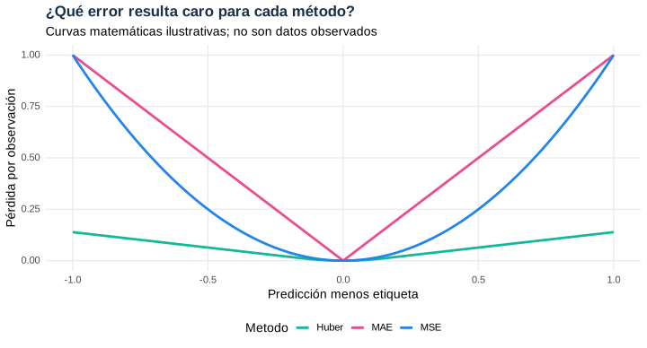
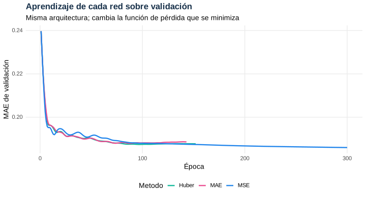

<div class="hero">
<span class="eyebrow">REDES NEURONALES · RETROPROPAGACIÓN · R PURO</span>
<h1>La misma pérdida, una función más flexible</h1>
<p>Construimos una pequeña red neuronal sin TensorFlow, Python ni GPU. Cambiaremos únicamente la función de pérdida: MSE, MAE y Huber.</p>
<p class="pillrow"><span>Datos oficiales STS</span><span>3 entradas numéricas</span><span>8 neuronas ocultas</span><span>3 pérdidas</span></p>
</div>

## 1. La pregunta y los datos que ya conocemos

En los laboratorios anteriores construimos, con *texto real* de STS Benchmark,
tres características de cada par de oraciones:

1. Coseno entre los promedios de embeddings GloVe.
2. Índice de Jaccard entre palabras de las dos oraciones.
3. Diferencia logarítmica de sus longitudes.

Nuestro objetivo sigue siendo predecir la similitud humana normalizada entre
0 y 1. El cambio es **la clase de funciones** que permitimos al modelo.

La regresión clásica estima

\[
\widehat y=\beta_0+\beta^\top x,
\]

mientras la red utiliza

\[
z=\tanh(W_1^\top x+b_1),\qquad
\widehat y=\sigma(W_2^\top z+b_2),\qquad
\sigma(t)=\frac{1}{1+e^{-t}}.
\]

Esta arquitectura tiene **tres entradas, una capa oculta de ocho unidades y
una salida**. No es BERT ni un modelo lingüístico de gran escala: los embeddings
ya fueron calculados antes, y ahora aprenderemos una función predictiva sobre
ellos. La sigmoide garantiza una salida en \([0,1]\), a diferencia de LS/LAD/Huber
lineales sin restricción.


``` r
# PASO 1. Compilar ANTES S4_Laboratorio_STS.Rmd.
# Ese cuaderno crea un RDS de características derivadas de la base STS oficial.
archivo <- "datos/STS_features_app.rds"
if (!file.exists(archivo))
  stop("Ejecute primero S4_Laboratorio_STS.Rmd para generar ",archivo)

# PASO 2. Leer las particiones originales sin rediseñarlas.
d <- readRDS(archivo)
stopifnot(all(c("train","valid","test","predictores") %in% names(d)))
rasgos <- d$predictores
Xtrain <- as.matrix(d$train[rasgos])
Xvalid <- as.matrix(d$valid[rasgos])
Xtest  <- as.matrix(d$test[rasgos])
ytrain <- as.numeric(d$train$score)
yvalid <- as.numeric(d$valid$score)
ytest  <- as.numeric(d$test$score)

stopifnot(ncol(Xtrain)==3L, all(is.finite(Xtrain)),
          all(is.finite(Xvalid)),all(is.finite(Xtest)),
          all(ytrain>=0 & ytrain<=1))
print(data.frame(
  Particion=c("Entrenamiento","Validación","Prueba"),
  Pares=c(nrow(Xtrain),nrow(Xvalid),nrow(Xtest)),
  Variables=c(ncol(Xtrain),ncol(Xvalid),ncol(Xtest))))
```

```
##       Particion Pares Variables
## 1 Entrenamiento  5749         3
## 2    Validación  1500         3
## 3        Prueba  1379         3
```

**Interpretación de la tabla:** las tres particiones tienen las mismas columnas
y conservan las etiquetas originales. Las medias y desviaciones estándar usadas
para normalizarlas se calcularon en el cuaderno principal **solo con
entrenamiento**. Validación orientará la selección; prueba se inspeccionará al
final. Nunca entrenaremos sobre esas etiquetas de prueba.

## 2. Tres funciones de pérdida y sus derivadas

Para un residuo \(e=\widehat y-y\), utilizaremos:

\[
L_{\mathrm{MSE}}(e)=e^2,\quad
L_{\mathrm{MAE}}(e)=|e|,\quad
L_{\mathrm{Huber}}(e)=
\begin{cases}
\tfrac12e^2,&|e|\leq\delta,\\
\delta(|e|-\tfrac12\delta),&|e|>\delta.
\end{cases}
\]

En esta práctica, \(\delta=0.15\) está expresado directamente en **puntos
de similitud**. No es idéntico al parámetro interno de escala robusta que usa
`MASS::rlm`. El objetivo MSE de esta sección es el mismo *tipo de pérdida*
que LS, y MAE el mismo que LAD; **el modelo no es lineal** porque las salidas
dependen de funciones no lineales y muchos pesos.


``` r
# PASO 1. Crear una rejilla de errores hipotéticos SOLO para dibujar funciones.
e <- seq(-1,1,length.out=301)
delta <- 0.15
curvas <- rbind(
  data.frame(Error=e,Perdida=e^2,Metodo="MSE"),
  data.frame(Error=e,Perdida=abs(e),Metodo="MAE"),
  data.frame(Error=e,Perdida=ifelse(abs(e)<=delta,.5*e^2,
                          delta*(abs(e)-.5*delta)),Metodo="Huber"))
ggplot2::ggplot(curvas,ggplot2::aes(x=Error,y=Perdida,colour=Metodo)) +
  ggplot2::geom_line(linewidth=1.3) +
  ggplot2::scale_colour_manual(values=c(Huber=color_huber,MAE=color_lad,MSE=color_ls)) +
  ggplot2::labs(title="¿Qué error resulta caro para cada método?",
                subtitle="Curvas matemáticas ilustrativas; no son datos observados",
                x="Predicción menos etiqueta",y="Pérdida por observación") + tema()
```

<div class="figure" style="text-align: center">

<p class="caption">Las mismas tres ideas estadísticas aparecen como pérdidas al entrenar redes.</p>
</div>

Para retropropagar necesitamos derivar la pérdida respecto de la predicción:

\[
\frac{\partial L_{\mathrm{MSE}}}{\partial\widehat y}=2e,\quad
\frac{\partial L_{\mathrm{MAE}}}{\partial\widehat y}=\operatorname{sign}(e),\quad
\frac{\partial L_{\mathrm{Huber}}}{\partial\widehat y}=
\begin{cases} e,&|e|\leq\delta,\\
\delta\operatorname{sign}(e),&|e|>\delta.
\end{cases}
\]

Para MAE tomamos el **subgradiente cero en \(e=0\)**. En Huber la derivada es
continua en el umbral. Las dos pérdidas robustas evitan que la magnitud del
gradiente por residuo crezca sin límite, pero **no garantizan** mejor rendimiento
fuera de muestra.

## 3. Construir y auditar una red con matrices de R


``` r
# PASO 1. Inicializar todos los pesos con la misma semilla para una
# comparación justa entre pérdidas: tres entradas, ocho neuronas ocultas.
inicializar <- function(p=3L,h=8L,semilla=41L) {
  set.seed(semilla)
  list(W1=matrix(rnorm(p*h,sd=0.15),nrow=p,ncol=h),
       b1=rep(0,h),
       W2=rnorm(h,sd=0.15),
       b2=0)
}

# PASO 2. Propagación hacia delante (forward pass).
propagar <- function(red,X) {
  Z1 <- sweep(X %*% red$W1,2,red$b1,"+")
  H <- tanh(Z1)
  z2 <- as.numeric(H %*% red$W2)+red$b2
  pred <- plogis(z2)
  list(H=H,pred=pred)
}

# PASO 3. Pérdidas: promedio en todas las observaciones.
perdida <- function(y,pred,metodo,delta=0.15) {
  e <- pred-y
  if (metodo=="MSE") return(mean(e^2))
  if (metodo=="MAE") return(mean(abs(e)))
  if (metodo=="Huber")
    return(mean(ifelse(abs(e)<=delta,0.5*e^2,
                       delta*(abs(e)-0.5*delta))))
  stop("Pérdida no reconocida")
}

# PASO 4. Regla de la cadena: gradientes de TODOS los parámetros.
# (a) derivar la pérdida con respecto a la predicción;
# (b) derivar la sigmoide: p(1-p);
# (c) derivar tanh: 1-H^2;
# (d) usar productos matriciales para sumar sobre el lote completo.
gradientes <- function(red,X,y,metodo,delta=0.15) {
  A <- propagar(red,X)
  e <- A$pred-y
  dl_dp <- switch(metodo,
    MSE=2*e,
    MAE=sign(e),
    Huber=ifelse(abs(e)<=delta,e,delta*sign(e)))
  if (is.null(dl_dp)) stop("Método desconocido")

  # Dividimos por n porque la pérdida definida es un PROMEDIO.
  dz2 <- dl_dp * A$pred*(1-A$pred)/nrow(X)
  gW2 <- as.numeric(crossprod(A$H,dz2))
  gb2 <- sum(dz2)

  # Repartir gradiente de salida a las ocho neuronas ocultas.
  dz1 <- tcrossprod(dz2,red$W2)*(1-A$H^2)
  gW1 <- crossprod(X,dz1)
  gb1 <- colSums(dz1)
  list(W1=gW1,b1=gb1,W2=gW2,b2=gb2)
}

# PASO 5. Verificar magnitudes antes de comenzar a entrenar.
red_inicial <- inicializar()
g0 <- gradientes(red_inicial,Xtrain,ytrain,"MSE")
print(data.frame(
  Parametro=c("W1","b1","W2","b2"),
  Cantidad=c(length(g0$W1),length(g0$b1),length(g0$W2),length(g0$b2))))
```

```
##   Parametro Cantidad
## 1        W1       24
## 2        b1        8
## 3        W2        8
## 4        b2        1
```

**Interpretación:** `W1` contiene 24 pesos que conectan las tres entradas con
las ocho unidades ocultas; `b1` son ocho interceptos internos; `W2`, ocho
pesos de salida; y `b2`, un intercepto final. En total hay
**41 parámetros entrenables**.
Por comparación, el modelo lineal con tres predictores tiene **cuatro**.
Tener más parámetros permite interacciones no lineales, pero también aumenta
el riesgo de sobreajuste.


``` r
# PASO 6. Comprobación numérica independiente de UN gradiente.
# Una derivada analítica equivocada puede producir un entrenamiento que parece
# avanzar y sin embargo está conceptualmente mal.
h <- 1e-5
r_mas <- red_inicial; r_menos <- red_inicial
r_mas$W1[1,1] <- r_mas$W1[1,1]+h
r_menos$W1[1,1] <- r_menos$W1[1,1]-h
f_mas <- perdida(ytrain,propagar(r_mas,Xtrain)$pred,"MSE")
f_menos <- perdida(ytrain,propagar(r_menos,Xtrain)$pred,"MSE")
grad_numerico <- (f_mas-f_menos)/(2*h)
grad_analitico <- g0$W1[1,1]
error_gradiente <- abs(grad_numerico-grad_analitico)
print(data.frame(Gradiente_analitico=grad_analitico,
                 Gradiente_numerico=grad_numerico,
                 Diferencia=error_gradiente))
```

```
##             Gradiente_analitico Gradiente_numerico   Diferencia
## cos_glove_z        -0.002279602       -0.002279602 1.673692e-13
```

``` r
stopifnot(is.finite(error_gradiente),error_gradiente<1e-5)
```

**Interpretación de la auditoría:** las dos derivadas deben ser prácticamente
iguales. La verificación con diferencias finitas **no demuestra** que cada
derivada sea perfecta, pero confirma un elemento importante del cálculo de
retropropagación. Es una prueba de corrección del algoritmo, no de calidad
predictiva.

## 4. Entrenar las tres redes con Adam, en R puro

Usamos Adam para actualizar parámetros con promedios móviles de gradientes
y sus cuadrados. Así no dependemos de Python, TensorFlow ni GPU. Las redes
comienzan **con los mismos pesos**, usan la misma arquitectura, los mismos
datos y el mismo número máximo de épocas. Cada red utiliza una única pérdida
de entrenamiento. Solo la **validación** determina qué época conservar.


``` r
# PASO 1. Esta función hace una época completa de gradiente y Adam.
# Se conservan los pesos con menor MAE de VALIDACIÓN (early stopping).
entrenar_red <- function(metodo,epocas=300L,tasa=0.035,
                         delta=0.15,paciencia=55L) {
  red <- inicializar(semilla=41L)
  m <- lapply(red,function(z) z*0)
  v <- lapply(red,function(z) z*0)
  mejor <- red
  mejor_mae <- Inf
  epoca_mejor <- 0L
  historia <- data.frame(Epoca=integer(),
                         Perdida_train=numeric(),MAE_valid=numeric())

  for (t in seq_len(epocas)) {
    g <- gradientes(red,Xtrain,ytrain,metodo,delta)

    # PASO 2. Adam con corrección de sesgo en cada parámetro.
    for (nom in names(red)) {
      m[[nom]] <- 0.9*m[[nom]]+0.1*g[[nom]]
      v[[nom]] <- 0.999*v[[nom]]+0.001*g[[nom]]^2
      m_corr <- m[[nom]]/(1-0.9^t)
      v_corr <- v[[nom]]/(1-0.999^t)
      red[[nom]] <- red[[nom]]-tasa*m_corr/(sqrt(v_corr)+1e-8)
    }

    p_train <- propagar(red,Xtrain)$pred
    p_valid <- propagar(red,Xvalid)$pred
    l_train <- perdida(ytrain,p_train,metodo,delta)
    mae_val <- mean(abs(yvalid-p_valid))
    historia <- rbind(historia,data.frame(
      Epoca=t,Perdida_train=l_train,MAE_valid=mae_val))

    # PASO 3. Guardar los mejores parámetros SIN mirar test.
    if (mae_val < mejor_mae-1e-7) {
      mejor <- red
      mejor_mae <- mae_val
      epoca_mejor <- t
    }
    if (t-epoca_mejor >= paciencia) break
  }
  list(red=mejor,metodo=metodo,mejor_mae=mejor_mae,
       epoca_mejor=epoca_mejor,historia=historia)
}

# PASO 4. Ajustar tres modelos con exactamente la misma entrada.
metodos <- c("MSE","MAE","Huber")
redes <- setNames(lapply(metodos,entrenar_red),metodos)
resumen_epocas <- data.frame(
  Perdida=metodos,
  Epocas_realizadas=vapply(redes,function(x)nrow(x$historia),integer(1)),
  Mejor_epoca=vapply(redes,function(x)x$epoca_mejor,integer(1)),
  MAE_validacion=vapply(redes,function(x)x$mejor_mae,numeric(1)))
print(resumen_epocas,row.names=FALSE)
```

```
##  Perdida Epocas_realizadas Mejor_epoca MAE_validacion
##      MSE               300         300      0.1859890
##      MAE               143          88      0.1879336
##    Huber               152          97      0.1874259
```

### ¿Qué significa cada columna?

- `Perdida`: es el criterio que generó los gradientes. **No es** la métrica de
  evaluación; las tres redes se evaluarán con las mismas medidas.
- `Epocas_realizadas`: número de pasos sobre el conjunto completo de
  entrenamiento; si es menor que 300, se activó la parada temprana.
- `Mejor_epoca`: época con el MAE mínimo de validación durante el entrenamiento.
- `MAE_validacion`: discrepancia absoluta promedio entre etiqueta humana y
  predicción, en unidades de la escala STS entre 0 y 1.

**Advertencia:** elegir la época por validación es una forma legítima de ajuste
de hiperparámetros. Por ello, la tabla de validación **no es una estimación final
independiente** de rendimiento; esa función corresponde al conjunto de prueba.


``` r
curvas <- do.call(rbind,lapply(names(redes),function(nm)
  transform(redes[[nm]]$historia,Metodo=nm)))
ggplot2::ggplot(curvas,ggplot2::aes(Epoca,MAE_valid,colour=Metodo)) +
  ggplot2::geom_line(linewidth=1.1) +
  ggplot2::scale_colour_manual(values=c(MSE=color_ls,MAE=color_lad,Huber=color_huber)) +
  ggplot2::labs(title="Aprendizaje de cada red sobre validación",
    subtitle="Misma arquitectura; cambia la función de pérdida que se minimiza",
    x="Época",y="MAE de validación") + tema()
```

<div class="figure" style="text-align: center">

<p class="caption">Trayectorias de validación calculadas durante el entrenamiento con R.</p>
</div>

**Lectura del gráfico:** una curva descendente indica mejora de generalización
en validación, pero su forma puede oscilar; no confunda el valor de la función
de pérdida de entrenamiento con MAE de validación. Si una curva se estanca o
empeora, continuar el entrenamiento puede no ayudar.

## 5. Comparar con la regresión lineal que ya estudiamos

Para no dar ventaja artificial a la red, ajustamos también LS, LAD y Huber
lineales usando las **mismas tres características** y las mismas particiones.


``` r
# PASO 1. Ajustar cabezas lineales desde el mismo archivo de características.
f <- stats::as.formula(paste("score ~",paste(rasgos,collapse=" + ")))
base_train <- d$train
ls <- stats::lm(f,data=base_train)
lad <- quantreg::rq(f,tau=.5,data=base_train)
huber <- MASS::rlm(f,data=base_train,method="M",
                   psi=MASS::psi.huber,maxit=200)

# PASO 2. Una única función de evaluación para TODO modelo.
medir <- function(y,pred,nombre) data.frame(
  Modelo=nombre,
  MAE=mean(abs(y-pred)),
  RMSE=sqrt(mean((y-pred)^2)),
  Spearman=unname(cor(y,pred,method="spearman")))

comparar <- function(particion, X,y) {
  clasicos <- list(LS=ls,LAD=lad,Huber_lineal=huber)
  tabla_1 <- do.call(rbind,lapply(names(clasicos),function(nm)
    medir(y,as.numeric(predict(clasicos[[nm]],newdata=particion)),nm)))
  tabla_2 <- do.call(rbind,lapply(names(redes),function(nm)
    medir(y,propagar(redes[[nm]]$red,X)$pred,paste0("Red_",nm))))
  rbind(tabla_1,tabla_2)
}

# PASO 3. Validación: esta tabla sirve para seleccionar la familia/cabeza.
tabla_valid <- comparar(d$valid,Xvalid,yvalid)
tabla_valid <- tabla_valid[order(tabla_valid$MAE),]
print(transform(tabla_valid,MAE=round(MAE,4),RMSE=round(RMSE,4),
                Spearman=round(Spearman,4)),row.names=FALSE)
```

```
##        Modelo    MAE   RMSE Spearman
##       Red_MSE 0.1860 0.2273   0.6620
##     Red_Huber 0.1874 0.2307   0.6577
##       Red_MAE 0.1879 0.2317   0.6555
##           LAD 0.1926 0.2314   0.6462
##  Huber_lineal 0.1929 0.2314   0.6461
##            LS 0.1933 0.2313   0.6460
```

``` r
# PASO 4. Elección congelada antes de mirar prueba.
seleccionado <- tabla_valid$Modelo[1]
cat("Modelo seleccionado por MAE de validación:",seleccionado,"\n")
```

```
## Modelo seleccionado por MAE de validación: Red_MSE
```

``` r
# PASO 5. Recién ahora calcular la tabla en PRUEBA.
tabla_test <- comparar(d$test,Xtest,ytest)
tabla_test <- tabla_test[order(tabla_test$MAE),]
print(transform(tabla_test,MAE=round(MAE,4),RMSE=round(RMSE,4),
                Spearman=round(Spearman,4)),row.names=FALSE)
```

```
##        Modelo    MAE   RMSE Spearman
##     Red_Huber 0.2035 0.2504   0.5747
##       Red_MAE 0.2037 0.2513   0.5726
##       Red_MSE 0.2039 0.2477   0.5808
##           LAD 0.2115 0.2533   0.5591
##  Huber_lineal 0.2116 0.2528   0.5600
##            LS 0.2122 0.2532   0.5598
```

### Cómo interpretar los seis resultados

- **LS y Red_MSE** usan pérdida cuadrática, pero una familia es lineal y la
  otra no lineal. Diferencias de error no se deben solamente a la pérdida.
- **LAD y Red_MAE** comparten pérdida absoluta; MAE optimiza su subgradiente
  a través de una red no convexa, mientras la regresión LAD lineal resuelve
  un problema de optimización convexo en sus coeficientes.
- **Huber_lineal y Red_Huber** emplean versiones relacionadas de una pérdida
  robusta, pero sus parámetros de escala no son necesariamente iguales.
- **MAE** y **RMSE** están en *puntos de similitud*; Spearman mide ordenación.
- El modelo preseleccionado es **Red_MSE**, con MAE de validación
  **0.1860**. Su MAE en prueba fue
  **0.2039**.
  El mejor resultado de prueba visto después **no cambia** esa elección.

Las diferencias pequeñas pueden ser producto de variabilidad de inicialización,
partición, calidad del embedding, optimización o regularización. **No es válido
declarar que una red “supera a la estadística” basándose solo en la complejidad
de su arquitectura.**

## 6. Ejemplos reales: examinar fallos, no solo promedios


``` r
# PASO 1. Recuperar la predicción del modelo seleccionado en prueba.
if (seleccionado %in% names(redes)) stop("Nombre no esperado")
if (startsWith(seleccionado,"Red_")) {
  id <- sub("^Red_","",seleccionado)
  p_test <- propagar(redes[[id]]$red,Xtest)$pred
} else {
  objeto <- switch(seleccionado,LS=ls,LAD=lad,Huber_lineal=huber)
  p_test <- as.numeric(predict(objeto,newdata=d$test))
}

# PASO 2. Seleccionar los cinco errores absolutos más grandes.
peores <- order(abs(ytest-p_test),decreasing=TRUE)[1:5]
casos <- data.frame(
  Etiqueta_humana=round(ytest[peores],3),
  Prediccion=round(p_test[peores],3),
  Error_absoluto=round(abs(ytest[peores]-p_test[peores]),3),
  Frase_A=substr(d$test$sentence1[peores],1,100),
  Frase_B=substr(d$test$sentence2[peores],1,100))
print(casos,row.names=FALSE)
```

```
##  Etiqueta_humana Prediccion Error_absoluto                           Frase_A
##             0.95      0.123          0.827      The lady peeled the potatoe.
##             0.00      0.723          0.723                 You should do it.
##             0.00      0.682          0.682              There is no maximum.
##             0.00      0.681          0.681 Microwave would be your best bet.
##             0.00      0.674          0.674             It's not a good idea.
##                         Frase_B
##    A woman is peeling a potato.
##      You should prime it first.
##  There is no quarantine period.
##      Your best bet is research.
##           It's a good question.
```

**Interpretación:** los errores mayores suelen ser los más instructivos.
Inspeccione negaciones, sustitución de entidades, cifras diferentes o
paráfrasis con pocas palabras en común. El texto de estas filas viene del
conjunto de prueba oficial; la selección de ejemplos por error **sirve para
diagnóstico**, nunca para volver a ajustar el modelo de esta evaluación.

## 7. Actividad de investigación y preguntas para discutir

1. ¿Por qué cambiar la pérdida altera los gradientes, aunque mantengamos fija
   la arquitectura de la red?
2. La pérdida MAE tiene una esquina en cero. ¿Qué significa usar `sign(e)` como
   subgradiente? ¿En qué punto falla la derivabilidad ordinaria?
3. ¿Por qué la red puede tener mejor MAE de entrenamiento y peor MAE de prueba?
4. Cambie a 4 y 16 neuronas y compare errores sin tocar la prueba hasta la
   decisión final. ¿La flexibilidad adicional siempre ayuda?
5. Repita cada modelo con cinco semillas de inicialización y documente la
   dispersión del MAE de validación. ¿Cuál muestra menor variación?
6. ¿Qué aspectos del lenguaje no pueden representar tres resúmenes numéricos,
   aun usando una red neuronal más grande?

### Una conclusión que debe quedar clara

**LS, LAD y Huber no son técnicas reemplazadas por las redes neuronales.** Sus
funciones objetivo reaparecen en cada paso de entrenamiento. Lo que cambia es
la familia de funciones aprendidas, el algoritmo de optimización y la cantidad
de parámetros. Los embeddings permiten traducir texto a números; la regresión
y la red transforman esas representaciones en predicciones. La validación
conecta ambas tradiciones con el mismo estándar de evidencia: desempeño
medido fuera del entrenamiento.

**Fuentes:** STS Benchmark de Cer et al. (2017), distribución
[Sentence-Transformers](https://huggingface.co/datasets/sentence-transformers/stsb);
GloVe de Pennington et al. (2014),
[ACL Anthology](https://aclanthology.org/D14-1162/);
Kingma y Ba (2015),
[Adam](https://arxiv.org/abs/1412.6980);
Huber (1964), *Robust Estimation of a Location Parameter*.

