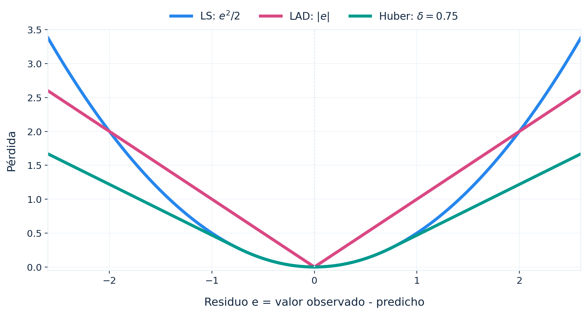

::: titlepage
UNIVERSIDAD DE LA SABANA / MATERIAL DE CLASE

**Regresión clásica\
en el corazón de la IA**

LS, LAD y Huber en redes neuronales\
y procesamiento de lenguaje natural

Guía conceptual y de interpretación estadística

Sesión 4 \| R/RStudio \| Noviembre de 2026

Casos reales: STS Benchmark y CLEAR Corpus
:::

# La pregunta que articula toda la sesión

Un algoritmo que procesa lenguaje natural debe convertir frases en
variables numéricas y aprender a predecir una salida observada. Los
métodos estudiados en sesiones anteriores siguen presentes en este
flujo: **definen la forma en que el algoritmo penaliza sus errores**.

::: idea
**Idea central.** Los *embeddings* determinan la representación numérica
de un texto. La familia de modelos (recta, plano, red neuronal)
determina la flexibilidad de la función predictiva. La función de
pérdida LS, LAD o Huber determina cómo se ajustan sus parámetros a los
datos.
:::

En la práctica principal, cada observación es un par de oraciones:
$$(s_i^{(1)},s_i^{(2)},y_i),\qquad y_i\in[0,1].$$ La etiqueta $y_i$ es
una puntuación de similitud semántica evaluada por personas. En la
versión original del **STS Benchmark** la escala es de 0 a 5; para este
laboratorio se normaliza dividiendo por 5. El código conserva las
particiones predefinidas y usa el archivo oficial.

# Tres niveles de un mismo problema de aprendizaje

## Representación: texto a vector

Una computadora procesa números. Un *embedding* asocia una palabra o una
oración a un vector $$E(s)\in\mathbb R^d.$$ Una representación simple
consiste en promediar los embeddings de sus palabras. Es fácil de
implementar y visualizar, pero no conserva adecuadamente el orden y
puede confundir negaciones. Una representación contextualizada, como
Sentence-BERT, modela interacciones entre palabras dentro de la oración.

Para dos oraciones, el coseno es
$$\mathrm{cos}(u,v)=\frac{\langle u,v\rangle}{\lVert u\rVert\lVert v\rVert},$$
si ambos vectores son no nulos. La similitud coseno es una
**característica del modelo**; $\mathrm{cos}(u,v)$ **no es** la etiqueta
humana $y_i$.

## Modelo predictivo: lineal o neuronal

La regresión lineal supervisada usa
$$\widehat y_i=\beta_0+\beta_1\,c_i+\beta_2\,j_i+\beta_3\,d_i,$$ donde
$c_i$ es coseno de embeddings, $j_i$ es Jaccard léxico y $d_i$ es una
diferencia de longitud. Una red multicapa aprende, por ejemplo,
$$h_1=\operatorname{ReLU}(W_1x+b_1),\quad
  h_2=\operatorname{ReLU}(W_2h_1+b_2),\quad
  \widehat y=\sigma(W_3h_2+b_3).$$ La estructura de red amplía la
familia funcional y usa más parámetros; eso no prueba mejor
generalización.

## Pérdida: qué significa «equivocarse»

Sea $e_i=y_i-\widehat y_i$ el residuo, con **esta convención de signo**
en toda la guía. $$\begin{aligned}
 \mathcal L_{\mathrm{LS}}(\beta)&=\sum_i e_i^2,\\
 \mathcal L_{\mathrm{LAD}}(\beta)&=\sum_i |e_i|,\\
 \mathcal L_{\mathrm{Huber}}(\beta)&=\sum_i\rho_\delta(e_i),\qquad
\rho_\delta(e)=
\begin{cases}\tfrac12e^2,&|e|\leq\delta,\\
\delta(|e|-\tfrac12\delta),&|e|>\delta.
\end{cases}
\end{aligned}$$ Para LS, si $X$ tiene rango completo,
$\widehat\beta=(X^\top X)^{-1}X^\top y$. LAD puede formularse como
programación lineal, introduciendo variables $u_i$ con $u_i\ge e_i$ y
$u_i\ge-e_i$. Huber se ajusta usualmente de manera iterativa.

# Por qué los errores extremos cambian el resultado

::: center
{width=93%}
:::

La escala relativa en la figura es *didáctica*: se dibuja $e^2/2$ para
compartir su derivada natural con Huber. En LS puede usarse $e^2$, que
tiene los mismos minimizadores. Huber es cuadrática cerca de cero y
crece linealmente en magnitud para errores grandes.

Las derivadas respecto del residuo son:
$$\psi_{\mathrm{LS}}(e)=2e,\qquad
 \psi_{\mathrm{LAD}}(e)\in\partial|e|,\qquad
 \psi_{\mathrm{Huber}}(e)=
 \begin{cases} e,&|e|\le\delta,\\
 \delta\operatorname{sign}(e),&|e|>\delta.
 \end{cases}$$ Por la regla de la cadena, al ajustar una red con
parámetros $\theta$, un error grande transmite gradientes de magnitud
creciente con LS y gradientes acotados respecto de $\widehat y$ con
Huber.

::: cuidado
**Precisión conceptual:** la robustez ante residuos extremos en $y$ no
equivale a protección frente a observaciones con valores extremos de las
variables explicativas. Son fenómenos distintos: *outlier vertical* y
*alto apalancamiento*.
:::

# Huber como regresión M y como pérdida neuronal

En regresión M de Huber se minimiza una suma de pérdidas robustas
aplicada a residuos *estandarizados por una escala* $s$. Con
$u_i=e_i/s$, la ecuación de estimación tiene la forma
$$\sum_i \psi_k(u_i)\,x_i=0,\qquad
  w_i=\frac{\psi_k(u_i)}{u_i}=
  \begin{cases}
   1,&|u_i|\le k,\\ k/|u_i|,&|u_i|>k.
  \end{cases}$$ `MASS::rlm(..., psi = psi.huber)` utiliza el umbral $k$
sobre residuales escalados. Estos pesos no son una probabilidad de que
una observación esté mal etiquetada. El valor habitual de $k=1.345$
corresponde a una calibración clásica bajo normalidad y no se identifica
con el umbral $\delta=0.15$ de una red que predice puntajes de similitud
0--1.

`keras3::loss_huber(..., delta=0.15)` especifica en cambio un $\delta$
medido en la *unidad de la respuesta*. MAE y MSE también se usan como
objetivos de redes. La retropropagación aplica la regla de la cadena a
estas pérdidas y calcula gradientes respecto de los pesos de cada capa.

# Conexión todavía más directa: GloVe y LS

GloVe construye embeddings de palabras a partir de una matriz
$X=(X_{ij})$ de coocurrencias. Su objetivo histórico es
$$J=\sum_{i,j} f(X_{ij})
 \left(w_i^\top \widetilde w_j+b_i+\widetilde b_j-\log X_{ij}\right)^2.$$
El término dentro del cuadrado intenta aproximar el logaritmo de la
coocurrencia por un producto interno de vectores, más sesgos. **Este
objetivo contiene mínimos cuadrados ponderados**. Sin embargo, por el
término bilineal $w_i^\top\widetilde w_j$, el problema no es una única
regresión lineal OLS convexa en todos los parámetros.

En R, `text2vec::GlobalVectors` ofrece una implementación formativa. El
cuaderno aprende GloVe únicamente con textos de entrenamiento, promedia
los vectores de las palabras de cada oración y obtiene una medida de
coseno. Este experimento es instructivo, pero no equivale a entrenar
modelos de frases de gran escala.

Con una arquitectura tipo Sentence-BERT, otro vínculo aparece en el
ajuste *supervisado* de similitud: la función `CosineSimilarityLoss` de
Sentence-Transformers utiliza MSE por defecto entre coseno y etiqueta.
La documentación permite sustituir la función de pérdida. El curso no
reproduce un entrenamiento integral de BERT porque requiere dependencias
y cómputo más elevados.

# Lectura detallada de las salidas de R

## LS: `summary(lm(...))`

  **Campo en R**                  **Interpretación correcta**
  ------------------------------- -----------------------------------------------------------------------------------------------------------------------
  `Call`                          Verifica variable respuesta y predictores incluidos.
  `Residuals`                     Describe errores de *entrenamiento*; signo negativo implica sobrepredicción si $e=y-\widehat y$.
  `Estimate`                      Efecto lineal asociado a una unidad de predictor; si está estandarizado, equivale a una desviación estándar original.
  `Std. Error`                    Precisión inferencial del coeficiente bajo el modelo asumido.
  `t value`                       Cociente entre estimación y error estándar.
  `Pr(>|t|)`                      Evidencia estadística frente a pendiente cero; no mide importancia educativa ni causalidad.
  `Residual standard error`       Dispersión residual estimada en las unidades de la respuesta.
  `Multiple/Adjusted R-squared`   Ajuste dentro de train; no mide desempeño fuera de muestra.
  `F-statistic`                   Contraste conjunto para las pendientes de LS bajo condiciones clásicas.

## LAD: `quantreg::rq(tau=.5)`

El estimador aproxima la *mediana condicional* cuando la especificación
cuantil es adecuada. Sus coeficientes interpretan cómo cambia esa
mediana al variar una característica con las restantes constantes.
`summary(...,se="boot")` usa un procedimiento de inferencia bootstrap;
la precisión depende del número de remuestreos. Un seudocoeficiente de
ajuste cuantil **no es el mismo** $R^2$ de OLS.

## Huber: `MASS::rlm`

La tabla de coeficientes presenta estimaciones y errores estándar
aproximados. No se debe inventar un valor $p$ clásico porque
`summary.rlm` no ofrece por defecto el mismo contraste con la misma
justificación inferencial de `lm`. Para mostrar incertidumbre, la
práctica calcula percentiles de bootstrap de pares completos y explica
qué supuestos quedan pendientes. La escala `s` y los pesos `w` son
diagnósticos propios de la regresión robusta.

## Interpretación de un coeficiente estandarizado

Suponga, a modo *estrictamente hipotético*, que el coeficiente LS del
coseno estandarizado es $0.12$, y la desviación estándar de ese coseno
en train es $0.30$. Un aumento de $0.10$ unidades del coseno original,
con otros predictores constantes, se asociaría con
$$0.12\frac{0.10}{0.30}=0.04$$ puntos de similitud humana normalizada.
En la escala STS de 0 a 5, serían $0.20$ puntos. Es importante **no**
llamar a esto un «incremento de 4 %»: 0.04 puntos y 4 puntos
porcentuales tienen interpretaciones distintas.

La plantilla del laboratorio `S4_Laboratorio_STS.Rmd` produce esta
narración con **sus propios coeficientes calculados**, sin emplear el
ejemplo hipotético como si fuera observado.

# Qué significan las métricas

$$\mathrm{MAE}=\frac1n\sum_i |y_i-\widehat y_i|,
 \quad
 \mathrm{RMSE}=\sqrt{\frac1n\sum_i(y_i-\widehat y_i)^2},
 \quad
 \rho_s=\operatorname{cor}_{\mathrm{Spearman}}(y,\widehat y).$$

-   **MAE:** tamaño habitual de la discrepancia, en puntos de la escala
    de salida. En STS normalizado, multiplicar por cinco recupera puntos
    de su escala original.

-   **RMSE:** aumenta relativamente más ante predicciones muy
    incorrectas y tiene las mismas unidades de la salida.

-   **Spearman:** correlación de rangos. Evalúa la capacidad de ordenar
    pares por similitud, independientemente de una calibración exacta.

-   **Validación:** sirve para tomar decisiones de arquitectura,
    parámetros e hiperparámetros.

-   **Prueba:** se utiliza para la estimación final de desempeño,
    después de fijar el procedimiento.

Un $\mathrm{MAE}=0.15$ en STS normalizado sería, *a modo de ejemplo*, un
promedio de $0.75$ puntos de discrepancia en la escala original de 0 a
5. Los resultados reales solo aparecen al ejecutar R.

# Experimento de robustez y lectura científica

La práctica compara tres ajustes sobre etiquetas originales y otros tres
sobre una copia de entrenamiento donde se invierte artificialmente una
fracción de puntuaciones. La partición de validación se deja intacta.
Las diferencias de MAE indican qué perdió o ganó cada procedimiento bajo
*esa perturbación simulada*; no se atribuyen errores a los anotadores de
STS.

Un examen riguroso necesita varias semillas, varios niveles de
contaminación y una respuesta explícita sobre qué se desea optimizar.
Huber y LAD pueden resistir algunos errores grandes, pero no existe
garantía de victoria en cualquier conjunto.

# La ampliación educativa: CLEAR Corpus

La práctica 4B utiliza el conjunto real **CLEAR Corpus**, con fragmentos
de lectura y una puntuación de *facilidad* estimada a partir de juicios
humanos. Una puntuación `BT_easiness` mayor indica facilidad relativa.
**No es porcentaje, probabilidad ni escala 0--1**.

Las variables explicativas del segundo caso son:

1.  $\log(1+\text{palabras})$, volumen textual transformado.

2.  $\text{palabras}/\text{oraciones}$, longitud media de las oraciones.

3.  Longitud media de palabra, característica léxica calculada en R.

Los modelos LS, LAD y Huber comparten estos predictores y el mismo
conjunto de evaluación. Una pendiente negativa para palabras por
oración, si aparece en datos reales, se leería como menor facilidad
estimada al aumentar la longitud de oración, controlando las demás
variables. Esto es una asociación, no evidencia de que editar esa
variable por sí sola cause una mejora medible.

El caso conecta estadística robusta con una aplicación auténtica de **IA
educativa**: ordenar textos para ofrecer materiales adecuados. Su
disponibilidad, licencia y trazabilidad se documentan en el repositorio
de sus autores.

# Secuencia didáctica sugerida: 110 minutos

::: center
  **Tiempo**     **Actividad**                               **Evidencia esperada**
  -------------- ------------------------------------------- ---------------------------------------------
  0--12 min      Frases semejantes, problema real y splits   Formulación de respuesta y métrica
  12--27 min     Curvas LS, LAD, Huber y gradientes          Explicación de sensibilidad a errores
  27--47 min     GloVe en R y similitud coseno               Interpretación de matriz y vector
  47--68 min     Ajustes LS/LAD/Huber                        Interpretación de coeficientes e intervalos
  68--85 min     Validación y contaminación artificial       Decisión justificada con MAE/RMSE
  85--100 min    Red neuronal y pérdidas                     Relación con backprop, límites
  100--110 min   Debate de aplicación CLEAR                  Propuesta argumentada de modelo
:::

::: cuidado
**Logística.** El entrenamiento GloVe y la descarga de dependencias se
deben preparar antes de la clase cuando se trabaja sin conexión
confiable. La red neuronal con TensorFlow y Sentence-BERT son módulos
opcionales de profundización. Los cuadernos principales pueden
ejecutarse con R y paquetes CRAN sin GPU.
:::

# Preguntas para evaluación formativa

1.  Compare matemáticamente la sensibilidad de los tres gradientes ante
    $e=3$.

2.  Explique por qué la regresión LAD estima una mediana condicional y
    cómo cambia la lectura de una pendiente frente a LS.

3.  Diferencie un *embedding* de una salida supervisada; ¿qué
    información de las etiquetas humanas conoce GloVe?

4.  Si una red tiene menor pérdida de entrenamiento y peor MAE de test,
    ¿qué conclusión corresponde?

5.  Explique por qué `lmrob` por defecto (estimación MM) no debe
    rotularse sin más como exactamente la misma regresión M de Huber de
    `MASS::rlm`.

6.  Defienda una elección de pérdida para una biblioteca de IA educativa
    donde algunos errores de dificultad pueden ser especialmente
    costosos.

# Fuentes primarias

1.  Pennington, J., Socher, R. y Manning, C. (2014). *GloVe: Global
    Vectors for Word Representation*. ACL.
    <https://aclanthology.org/D14-1162/>.

2.  Reimers, N. y Gurevych, I. (2019). *Sentence-BERT: Sentence
    Embeddings using Siamese BERT-Networks*. EMNLP.
    <https://aclanthology.org/D19-1410/>.

3.  Cer, D. et al. (2017). *SemEval-2017 Task 1: Semantic Textual
    Similarity Multilingual and Crosslingual Focused Evaluation*.
    <https://aclanthology.org/S17-2001/>.

4.  STS Benchmark, distribución oficial de Sentence-Transformers.
    <https://sbert.net/datasets/stsbenchmark.tsv.gz>.

5.  Crossley, S. et al. (2022). *A large-scaled corpus for assessing
    text readability*.
    <https://pmc.ncbi.nlm.nih.gov/articles/PMC10027808/>.

6.  Repositorio original de CLEAR Corpus.
    <https://github.com/scrosseye/CLEAR-Corpus>.

7.  Documentación R de `MASS::rlm`.
    <https://search.r-project.org/CRAN/refmans/MASS/html/rlm.html>.

8.  Documentación de `quantreg`.
    <https://search.r-project.org/CRAN/refmans/quantreg/html/rq.html>.

9.  Documentación de `keras3`. <https://keras3.posit.co/>.

10. Documentación de pérdidas de Sentence-Transformers.
    <https://sbert.net/docs/package_reference/sentence_transformer/losses.html>.
